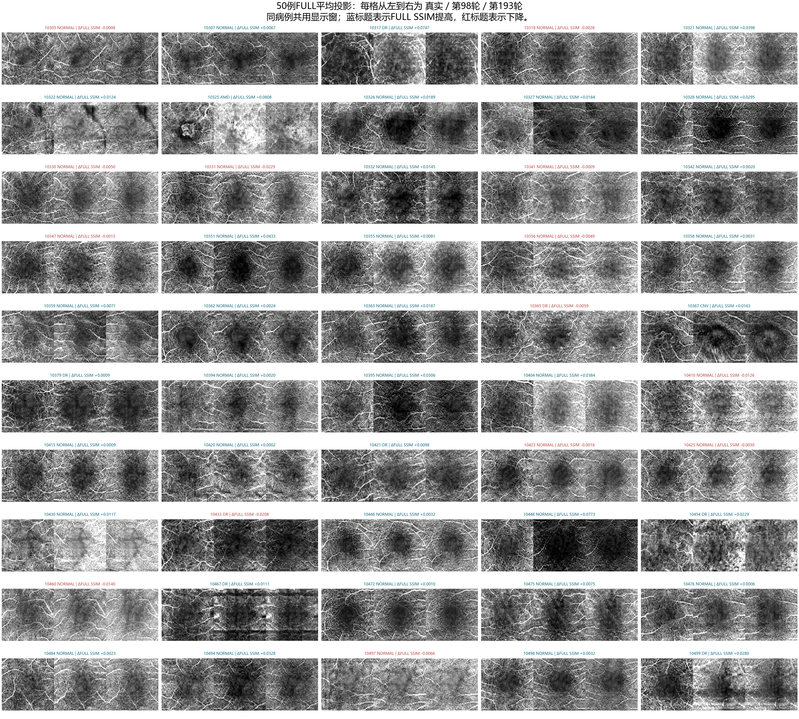

# FlowOCT 复现代码与实验结果

汇集 **FlowOCT 作者源码、实际复现工程、训练记录、逐例指标、结果图和二维投影数组**。整理日期：2026-10-29。

| 内容 | 入口 |
| --- | --- |
| 作者公开源码（锁定提交，17 个文件原样保存） | [upstream/](upstream/) |
| 实际复现代码：训练、断点恢复、测试与评价 | [flowoct_reproduction/](flowoct_reproduction/) |
| 复现工程安装与运行 | [运行说明](flowoct_reproduction/README.md)、[A100 入口](flowoct_reproduction/A100_START.md) |
| 全部复现结果导航 | **[结果总览](analysis/README.md)** |
| 论文、作者代码、复现代码的三列对照 | [2026-10-29 对照表](analysis/flowoct_comparison_20261028/FlowOCT_三列对照表_20261029.md) |
| 具体改动与依据 | [CHANGES.md](flowoct_reproduction/CHANGES.md)、[逐行补丁](flowoct_reproduction/provenance/) |
| 单病例拟合与训练/验证投影工具 | [单病例工具](FlowOCT_singlecase_tools/)、[训练验证工具](FlowOCT_trainval_projection_tools/) |
| 较早的最小修正版 | [working/](working/)（以 flowoct_reproduction 为本次正式复现入口） |
| 文件来源、校验和与收录范围 | [PUBLICATION_MANIFEST.json](PUBLICATION_MANIFEST.json)、[PUBLICATION_NOTES.md](PUBLICATION_NOTES.md) |

## 实际完成的主要实验

3M 数据按 140/10/50 划分，训练预算 200 轮，按验证体积 PSNR 选择第 **193** 轮模型，在 50 例测试集上评价。
八个核心源码文件与实际预测记录中的指纹一致，见 [运行与源码核对记录](analysis/flowoct_comparison_20261028/actual_run_verification.json)。

| 第 193 轮，50 例逐扫描等权平均 | 结果 |
| --- | ---: |
| 体积 MAE ↓ | 0.01395677 |
| 体积 PSNR ↑ | 29.350086 dB |
| 体积 SSIM ↑ | 0.80212371 |
| 物理 Z 最大投影 MAE ↓ | 0.08311595 |
| 物理 Z 最大投影 PSNR ↑ | 19.706465 dB |
| 物理 Z 最大投影 SSIM ↑ | 0.32500521 |

查看 [200 轮测试详细报告](analysis/flowoct_3m_best193_test_20261024/FlowOCT_200轮最佳模型测试分析.md)、[全部 50 例结果图](analysis/flowoct_3m_best193_test_20261024/FULL_review/figures/)、[逐例体积与最大投影指标](analysis/flowoct_3m_best193_test_20261024/FULL_review/per_case.csv)、[FULL 投影指标](analysis/flowoct_3m_best193_test_20261024/FULL_review/full_metrics.json)。

还保存了第 98 轮测试、70/140/313 轮固定训练与验证病例比较、400 轮单病例拟合、固定单切片对照，以及模糊、投影方向和损失区域检查。它们各有自己的实验设置，不能混作同一测试结果。

## 结果如何理解

复现沿用作者公开二维网络、二维 Haar 小波和主要损失，补齐数据适配、训练恢复及评价流程。作者源码来自 [cnu-medilab/FlowOCT](https://github.com/cnu-medilab/FlowOCT)，固定到提交 [`2309126956d2b80a95f2d307d85a50799cc658a6`](https://github.com/cnu-medilab/FlowOCT/tree/2309126956d2b80a95f2d307d85a50799cc658a6)。原有 MIT 版权声明保留。

本仓库的体积评价覆盖在线 resize 后的中心 256³ 裁剪，data_range=1。FULL 是沿物理 Z 的平均投影；最大投影另行报告。当前数据划分、离线预处理和作者未公开的评价细节尚未全部对齐，因此这些结果不能声称已复现论文表格，也不能把二维投影 PSNR 与论文三维体积 PSNR 直接比较。

复现工程原说明与 DELIVERY.json 记录的是 2026-10-20/21 交付时状态；正式训练后的证据位于 analysis/，请结合日期阅读。
