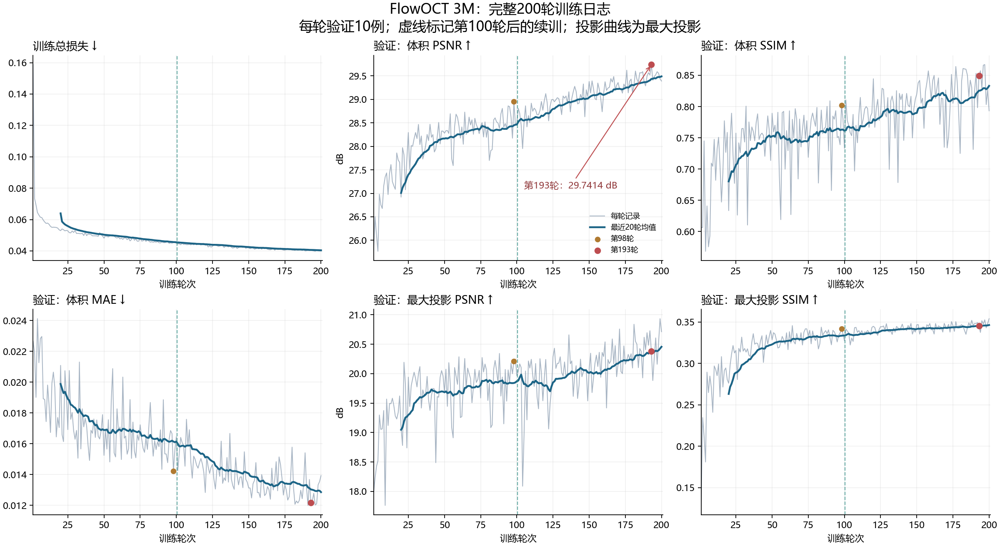

# FlowOCT 3M：200轮日志分析

分析日期：2026-10-24。来源：`D:\data\FSdata\flowoct_3m_train.log`，SHA-256：`336280bb3135b39c9c8242d502919198fd969b3a4d1220492f7808a62201f1a2`。

本次读取下载日志及本地训练/评价实现，生成分析图和报告；没有运行训练或重写模型权重。

## 完成情况与选模

日志包含连续、无重复的1–200轮完整训练与验证记录，最终global_step=28000；每轮验证10例。
启动记录从第1轮开始，中途从latest.pt恢复到第101轮。轮次和global_step连续；这能说明记录衔接正常，不能单凭日志证明续训数值与不中断运行逐位相同。

按既定的验证集平均体积PSNR选模，第193轮最好，为29.741367 dB。
按当前runner保存规则，训练目录中的best.pt应对应第193轮，latest.pt和epoch_0200.pt应对应第200轮。这里未加载服务器checkpoint，正式测试前应核对checkpoint的epoch字段。

以下均为同一日志中的验证集均值，不能和此前50例测试集结果混为同一组数据。

| 轮次 | 体积MAE ↓ | 体积PSNR ↑ / dB | 体积SSIM ↑ | 最大投影PSNR ↑ / dB | 最大投影SSIM ↑ |
| ---: | ---: | ---: | ---: | ---: | ---: |
| 98 | 0.01424 | 28.9526 | 0.8018 | 20.2132 | 0.3421 |
| 193 | 0.01217 | 29.7414 | 0.8490 | 20.3794 | 0.3456 |
| 197 | 0.01211 | 29.5893 | 0.8672 | 20.1598 | 0.3527 |
| 200 | 0.01393 | 29.3913 | 0.7932 | 20.7118 | 0.3541 |

第193轮相较第98轮：体积PSNR提高0.7887 dB，体积MAE下降14.50%，体积SSIM提高0.0473。
最大投影SSIM仅提高0.0035，说明投影结构指标的收益小于体积指标收益；是否恢复更多细血管还需相同病例的图像和逐例指标核对。

## 后100轮的收益与波动

以下对每轮10例验证均值再做阶段平均，用于观察趋势；它不是独立重复实验，也不能据此计算跨病例显著性。

| 轮次范围 | 体积PSNR / dB | 体积MAE | 体积SSIM | 最大投影SSIM |
| --- | ---: | ---: | ---: | ---: |
| 81–100 | 28.4644 | 0.01614 | 0.7614 | 0.3337 |
| 101–120 | 28.7026 | 0.01511 | 0.7797 | 0.3374 |
| 121–140 | 28.9652 | 0.01423 | 0.7909 | 0.3414 |
| 141–160 | 29.0965 | 0.01361 | 0.8095 | 0.3425 |
| 161–180 | 29.3056 | 0.01350 | 0.8056 | 0.3439 |
| 181–200 | 29.4898 | 0.01286 | 0.8331 | 0.3464 |

后期训练损失仍下降，验证阶段平均总体改善，没有出现持续的整体恶化。个别轮次的SSIM波动较大：第197轮为0.8672，第200轮为0.7932。
本地实现对验证数据采用固定中心裁剪、关闭翻转，并从OCT开始执行固定三步Euler推理；没有随机噪声初值。因此不能把这些轮间变化解释为随机验证裁剪；每轮权重变化及病例响应可能参与其中，但该日志不包含逐例预测，不能唯一归因。
第197轮体积SSIM最高，第191轮体积MAE最低，第199轮最大投影PSNR最高，第200轮最大投影SSIM最高。不同指标的最优轮次不一致，正式结果应继续采用事先约定的体积PSNR选模规则，避免事后挑指标换模型。

## 损失、显存与异常

第193轮训练平均总损失为0.040520。四项损失乘权重后的贡献分别为：速度项0.008640、L1项0.009570、对比项0.019839、投影项0.002471。
这些项的尺度和定义不同，不能用原始数值大小直接判断哪项学得好。

全部已解析数值均有限，没有记录Traceback、显存不足或CUDA错误；best_validation_psnr与逐轮累计最大值一致。
日志有两条相同的TorchIO兼容性警告，分别出现在首次启动与续训启动。当前本地加载器将数据转为张量字典并使用自定义collate；这条通用警告本身不能证明批次错误，日志也不足以独立核验所有输入内容。

峰值allocated显存范围25.1722–25.2402 GiB，没有随轮次持续增大的迹象；该数值不是nvidia-smi整卡占用，也不是reserved显存。
日志开头记录A100 80GB、network_chunk=0、每病例64张切片。

记录的训练耗时26.36小时，验证耗时4.03小时，合计30.39小时，平均每轮9.12分钟。
这些计时不含模型保存、中断、排队和其他未记录开销，因此不能等同于从启动到结束的自然时间。

## 后续评价

200轮预算已完成，建议将此结果作为本次预定训练的终点，用更新后的best.pt（按日志应为第193轮）在原50例测试集上重新推理，保留此前第98轮输出，进行逐病例配对比较。
仍可保留epoch_0200.pt作为最后一轮的补充结果，但不要用测试集指标决定主模型。

日志里的axial_mip是沿深度的最大投影，不是OCTA-500 FULL平均投影。本次日志没有新best模型的FULL平均投影、测试集评价或图像，不能声称这些测试结果已经改善，也不能仅据该日志认定达到论文完整复现水平。

