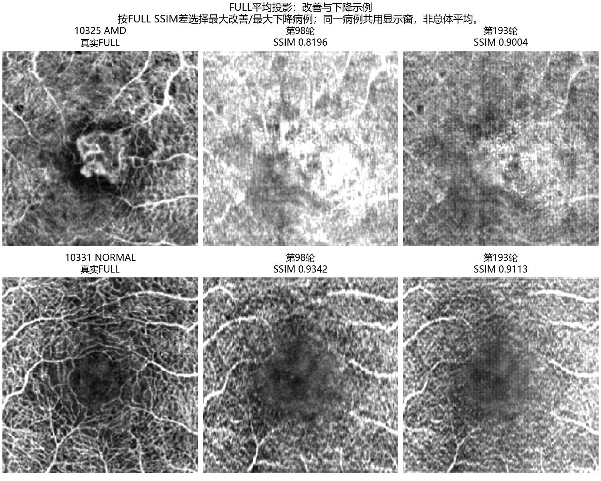

# FlowOCT：200轮预算内最佳模型的测试与FULL投影分析

分析日期：2026-10-24。测试模型实际为第193轮，不是最后第200轮。病例：与第98轮完全相同的50例3M测试病例。

本次结论：FULL平均投影整体改善，体积PSNR也提高；体积SSIM下降，最大投影指标没有同步改善。因此不能将新模型概括为全面优于第98轮。当前结果支持分别报告体积、FULL平均投影与最大投影。

## 已生成的图和数据

- [第193轮50例FULL与中心B-scan对照图](FULL_review/figures)
- [第98/193轮全部50例FULL配对总览](FULL_50例配对总览.png)
- [改善与下降代表图](代表病例_FULL对照.png)
- [两轮测试指标配对分布](配对指标比较.png)
- [6例详细配对图](paired_examples)
- [完整配对数据与核对记录](paired_analysis.json)
- [原包、模型及解压记录核对](input_verification.json)

每张第193轮单病例PNG包含真实FULL、预测FULL、FULL绝对误差、真实中心B-scan、预测中心B-scan及其误差。配对图同时显示GT、第98轮和第193轮。

## 数据与模型核对

- 实际读取best.pt：第193轮，global_step=27020，最佳验证体积PSNR=29.7413669 dB，预算200轮，network_chunk=0。
- best.pt SHA-256与prediction.json一致：42676f6219106bfcf4b25dc275172d827ddeeec96c97721d2b91db0c70693832。
- 本地tar包含50个NPZ及模型、配置和评价记录；61个解压文件的数量/尺寸与tar一致，全部非NPZ文件的内容哈希与tar一致。
- 两轮测试病例、病例/疾病标签、manifest哈希、完整运行配置、核心源码指纹和依赖版本一致。
- 全部50例真实OCTA体素逐元素一致；全部50例输入OCT的NPY成员CRC32及长度一致。没有重读全部输入OCT体素做逐元素比较。
- 全部50例体积MAE/PSNR、最大投影指标、FULL指标在本地重算；体积SSIM独立重算了3例：10305, 10325, 10330。重算指标与保存值最大绝对差为2.49e-14。
- 没有重训、修改模型或修饰预测体积；本次是对已有预测进行投影、统计和绘图。

本地原包身份SHA-256：332063ec74f3ef94a1aec925980aba778d1ebb12aa32268811c8b3fe617cc7b6。未取得服务器校验侧文件，因此这里的哈希用于本地追溯，不声称已完成与服务器原包的端到端校验。

## FULL平均投影结果

逐病例计算后等权平均；±为50例间总体标准差。

| 指标 | 第98轮 | 第193轮 | 193−98 | 改善病例 |
| --- | ---: | ---: | ---: | ---: |
| FULL平均投影 MAE ↓ | 0.00751 ± 0.00268 | 0.00678 ± 0.00170 | -0.00073 | 33/50 |
| FULL平均投影 PSNR ↑ / dB | 40.9105 ± 2.2487 | 41.5396 ± 1.7762 | +0.6291 | 33/50 |
| FULL平均投影 SSIM ↑ | 0.9279 ± 0.0348 | 0.9395 ± 0.0203 | +0.0115 | 36/50 |

FULL MAE下降约9.68%，PSNR提高0.6291 dB，SSIM提高0.01155。
50例中33例FULL MAE/PSNR改善，36例FULL SSIM改善，14例SSIM下降。SSIM差的中位数为+0.00321，小于均值+0.01155，表明少数较大改善对均值有贡献。
即使去掉AMD和CNV单例，正常及DR组的FULL平均指标也仍有改善，见分组表。

这些FULL指标是“预测体积的深度平均”与“同病例真实体积的深度平均”比较，范围为当前预处理后的中心体块。这里不是直接对官方显示BMP评分，也不是论文表格里的full volume指标；41.54 dB不能直接与论文体积PSNR比较。

## 体积与最大投影

| 指标 | 第98轮 | 第193轮 | 193−98 | 改善病例 |
| --- | ---: | ---: | ---: | ---: |
| 体积 MAE ↓ | 0.01357 ± 0.00284 | 0.01396 ± 0.00222 | +0.00039 | 18/50 |
| 体积 PSNR ↑ / dB | 28.8894 ± 0.9368 | 29.3501 ± 0.9045 | +0.4607 | 47/50 |
| 体积 SSIM ↑ | 0.8404 ± 0.0796 | 0.8021 ± 0.0774 | -0.0382 | 9/50 |
| 最大投影 MAE ↓ | 0.08062 ± 0.01558 | 0.08312 ± 0.01642 | +0.00250 | 19/50 |
| 最大投影 PSNR ↑ / dB | 19.9300 ± 1.4895 | 19.7065 ± 1.5493 | -0.2236 | 19/50 |
| 最大投影 SSIM ↑ | 0.3252 ± 0.0430 | 0.3250 ± 0.0440 | -0.0002 | 25/50 |

体积PSNR在47/50例提高，但体积SSIM仅9/50例提高、41例下降。体积MAE均值上升约2.89%。
最大投影PSNR平均下降0.2236 dB，最大投影SSIM基本持平。不能从FULL改善推断所有深度结构和极值血管信号都改善。

## 为什么FULL改善、体积SSIM却下降

指标关注点不同。体积PSNR来自三维MSE，FULL先沿深度平均再评价，三维SSIM则保留局部三维邻域信息。平均投影会合并不同深度的信号，降低部分深度误差的可见性；某些不同位置的正负误差还可能在平均时抵消。

本次额外进行了GT强度分组诊断：

| GT强度范围 | 体素占比 | 第98轮MAE | 第193轮MAE |
| --- | ---: | ---: | ---: |
| GT<=0.01 | 77.37% | 0.002017 | 0.003593 |
| 0.01<GT<0.1 | 13.33% | 0.038879 | 0.034122 |
| GT>=0.1 | 9.30% | 0.073353 | 0.071276 |

GT<=0.01的低信号体素占77.37%，其MAE从0.002017上升到0.003593，约增加78.1%；中高强度区域MAE则下降。
这说明新模型减少了部分较大误差，同时在大量低信号位置留下了更多小幅残留。它与“体积PSNR升高，但MAE/SSIM下降”并存的现象一致。

这些阈值只用于本次误差诊断，不是论文前景掩膜、血管分割或训练修改。它提供一个有数据支持的解释，不能单独证明SSIM下降的全部原因或判定过拟合。

## 图像观察与代表病例

| 病例 | 类别 | FULL SSIM：98 → 193 | 体积SSIM：98 → 193 | 查看 |
| --- | --- | ---: | ---: | --- |
| 10331 | NORMAL | 0.9342 → 0.9113 | 0.8854 → 0.7433 | [配对图](paired_examples/10331.png) |
| 10325 | AMD | 0.8196 → 0.9004 | 0.4907 → 0.7375 | [配对图](paired_examples/10325.png) |
| 10330 | NORMAL | 0.9462 → 0.9412 | 0.7934 → 0.6198 | [配对图](paired_examples/10330.png) |
| 10367 | CNV | 0.9048 → 0.9211 | 0.8678 → 0.8677 | [配对图](paired_examples/10367.png) |
| 10305 | NORMAL | 0.9629 → 0.9621 | 0.8904 → 0.8653 | [配对图](paired_examples/10305.png) |
| 10433 | DR | 0.9268 → 0.9059 | 0.8762 → 0.8709 | [配对图](paired_examples/10433.png) |

- **10325（AMD，单例）**：第193轮减轻了第98轮的大片过亮现象，中心低信号区域及总体强度更接近GT。FULL和体积指标均改善。但细血管和局部结构仍有模糊与不匹配；只有1例，不能据此声称AMD整体效果已提升。
- **10331（NORMAL）**：FULL SSIM下降最多，右侧偏亮残留更明显；三维SSIM也下降。是“训练更久并不保证每例更好”的反例。
- **10330（NORMAL）**：FULL两轮看起来相近，SSIM仅小幅下降，但体积SSIM从0.7934降到0.6198。中心切片误差图显示193轮低信号区域残留更明显，说明只看平面血管图会漏掉三维问题。
- **10433（DR）**：FULL SSIM从0.9268降到0.9059，作为DR组下降病例保留。
- **10367（CNV）**：FULL小幅改善，体积SSIM近似持平；只有1例，不能作组层面的结论。
- **10305（NORMAL）**：作为固定复核病例保留，FULL变化很小。

示例选择包含FULL SSIM最大改善、最大下降、体积SSIM最大下降、稀有疾病单例和固定复核病例。完整50例总览同时提供，避免只展示好看的病例。

## 疾病分组

| 类别 | 例数 | FULL PSNR：98 → 193 / dB | FULL SSIM：98 → 193 | 体积SSIM：98 → 193 |
| --- | ---: | ---: | ---: | ---: |
| NORMAL | 40 | 41.1400 → 41.5614 | 0.9320 → 0.9410 | 0.8477 → 0.7945 |
| DR | 8 | 40.7769 → 41.9084 | 0.9236 → 0.9387 | 0.8440 → 0.8402 |
| AMD | 1 | 33.4279 → 38.3108 | 0.8196 → 0.9004 | 0.4907 → 0.7375 |
| CNV | 1 | 40.2823 → 40.9471 | 0.9048 → 0.9211 | 0.8678 → 0.8677 |

NORMAL有40例，DR有8例；AMD和CNV各1例。体积SSIM的下降主要体现在NORMAL组，不能把AMD单例的大幅改善作为整体结果的替代。

## 统计与可比性

| 指标 | 平均差：193−98 | 病例配对bootstrap 95%区间 |
| --- | ---: | --- |
| 体积 PSNR ↑ / dB | +0.46067 | [+0.36251, +0.56099] |
| 体积 SSIM ↑ | -0.03825 | [-0.05799, -0.01632] |
| FULL平均投影 PSNR ↑ / dB | +0.62913 | [+0.23493, +1.05654] |
| FULL平均投影 SSIM ↑ | +0.01155 | [+0.00574, +0.01810] |

上述区间按同一病例的193−98差值做5000次病例bootstrap，seed=20261024，仅作为当前50例的探索性不确定性描述。病例/患者标签使用现有公开ID清单，稀有疾病样本不足，不提供临床或跨中心泛化结论。

## 投影与显示规则

1. NPZ中的轴顺序为ZYX，FULL取axis=0的算术平均，再转置为XY显示。
2. 每个病例的GT、第98轮和第193轮共用GT FULL min至P99灰度窗。不同病例窗口可以不同，不能直接比较跨病例的屏幕亮度。
3. 指标在未做显示拉伸的归一化[0,1]数组上计算，SSIM窗口7。
4. 当前输出是400x400缩放后的中心256x256横向范围和256层准备深度，横向为原3M视野的64%，约1.92mm；没有恢复完整3mm原始视野。
5. FULL是全保存深度平均，并不表示原始完整横向视野，也不恢复原始640层深度采样。
6. 切片图只展示中心Y切片；全体积指标和逐体素GT核对覆盖全部数据，不能用一个切片概括每个深度的结构。

## 后续实验建议

保留当前200轮预算下、按验证体积PSNR选出的第193轮作为主测试记录，同时报告FULL改善与体积SSIM下降。第98轮作为训练阶段对照，不在看完测试指标后随意替换主模型。
400轮延长训练已按原计划单独记录；结束后仍按同一验证规则选择模型，再用同一50例和同一投影、显示及指标设置评价。当前结果不能保证再训练一定改善SSIM，也没有据此修改损失、学习率或后处理预测值。

## 文件说明

FULL_review/figures保存第193轮50例PNG；FULL_review/projections保存二维GT和预测FULL。
comparison_arrays保存50例GT、98/193 FULL数组和同一中心B-scan，便于复核配对图。它们是轻量二维数据，原三维NPZ保持在D:/data/FSdata。
paired_analysis.json保留全部逐例指标、配对差和诊断结果。input_verification.json保留来源核对范围。
