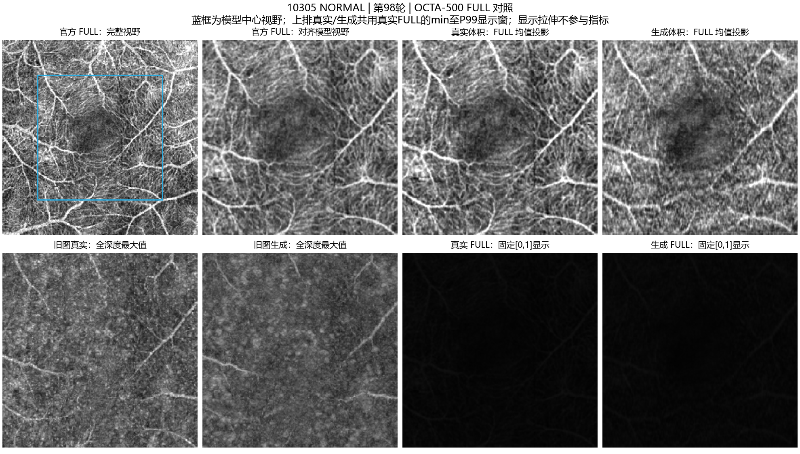
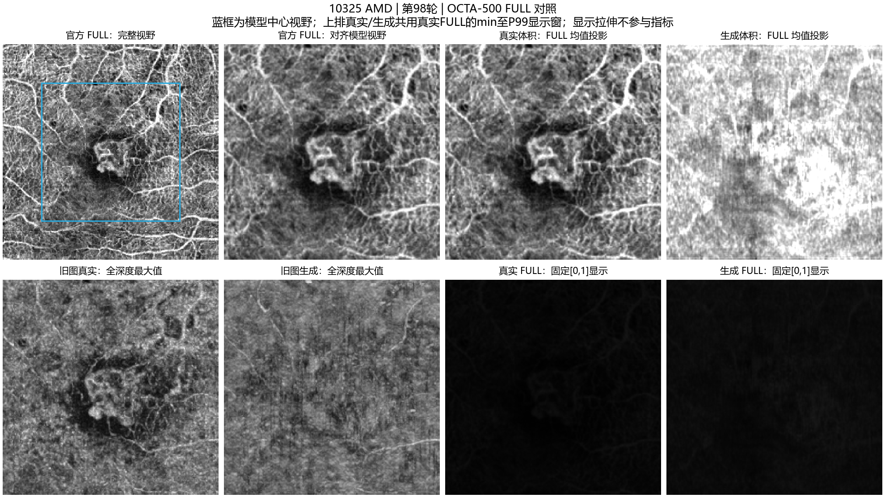

# OCTA-500 FULL投影核对与修正

用户对照的是OCTA-500的FULL图。此前提供的全深度最大值投影，与该投影定义不同。此前投影展示未充分对齐用户需要的官方FULL口径，现使用已有第98轮预测体积补算，不需要重新训练或推理。

## 1. 差异的来源

[OCTA-500原论文§3.3，B4](https://arxiv.org/pdf/2012.07261)将OCTA FULL定义为沿轴向的平均投影。B5和B6分别是ILM–OPL与OPL–BM层间的最大值投影。

旧脚本对保存的ZYX体积执行`volume.max(axis=0)`，同时以[0,1]固定窗口显示。因此与官方FULL存在四方面差异：

| 项目 | 此前展示 | 本次FULL对照 |
|---|---|---|
| 深度汇聚 | 全深度最大值 | 全深度算术均值 |
| 显示方向 | YX | XY，与本地官方BMP对齐 |
| 视野 | 400横向重采样后的256中心裁剪 | 保留相同模型视野，并与官方同区域图对照 |
| 显示窗口 | 固定[0,1] | 同时展示固定窗口和真实/预测共用的GT min至P99窗口 |

最大值图突出每条轴向射线上的最亮信号，均值图综合整条射线的强度，两者呈现的纹理不同。FULL中“全深度”不表示当前模型恢复了完整横向视野：模型只覆盖每个横向轴64%的原视野，3mm扫描中约为中心1.92mm范围。

## 2. 如何保证对齐

1. 使用下载的`flowoct_3m_best_preview`中全部50例预测，确认模型仍是第98轮、数据清单及预测体积均未改变。
2. 在10305和10325上，使用本地z256原数据和原TorchIO 0.20.4流程重做预处理。得到的真实裁剪体与下载NPZ中的`octa_gt`逐元素完全相同，裁剪和归一化记录也一致。
3. 从本地公共数据的`official_projections/3M/OCTA(FULL)`读取对应官方BMP。只对官方BMP做横向尺寸和中心裁剪对齐，用于可视化参考。
4. 预测和真实体积均沿物理Z轴取算术均值，并转置成与官方BMP一致的显示方向。
5. 定量评价使用未经显示拉伸的归一化投影，比较相同网格上的预测与GT，不把经过显示处理的官方BMP当作数值评价目标。

## 3. 第98轮50例FULL指标

| 指标 | 均值 ± 病例总体标准差 |
|---|---:|
| FULL MAE | 0.007507 ± 0.002684 |
| FULL PSNR | 40.9105 ± 2.2487 dB |
| FULL SSIM | 0.9279 ± 0.0348 |

旧最大值投影对应的19.9300dB和0.3252仍然是原评价对象上的结果，不能将新旧数值之差解读为模型提升。均值运算会平滑轴向误差，其数值范围通常也比最大值投影更小；在固定`data_range=1`下，这会影响PSNR及SSIM的数值水平。新指标仍是中心裁剪评价，不能直接标成官方全原始视野的逐像素复现，也不能代表分层血管恢复准确率。

## 4. 图像怎么读

全部50张图位于[本次FULL图片目录](octa500_full)。

上排依次为官方完整视野、官方对齐到模型区域、GT均值投影、预测均值投影。官方完整图上的蓝框标出模型覆盖区域。上排GT和预测共用GT最小值至99百分位的显示窗口，未分别优化对比度。

下排保留旧GT最大投影和旧预测最大投影，并给出固定[0,1]窗口下的两张FULL图。FULL在固定[0,1]窗口下较暗，是因为均值强度集中在较小范围；不能把这种显示偏暗直接解释为模型没有输出信号。官方BMP已带有自身的显示映射，其绝对灰度不保证与重新投影图完全相同。

10305的官方同区域图与GT重算均值投影在主要结构上可以对应，说明全深度均值、方向和裁剪已得到合理对齐。生成FULL可见主要亮暗结构，但局部纹理仍与GT有差别。此例FULL PSNR为43.7792dB，SSIM为0.9629；这些是原始投影数值的指标，不是拉伸后图片的指标。

10325的结构误差仍比一般病例明显，FULL PSNR约33.428dB、SSIM约0.8196。正确投影可以消除展示口径差异，不能自动消除生成结果本身的误差。

## 5. 本次修改范围

新增独立的后处理脚本`compare_full_projection.py`、50张FULL对照PNG和`full_metrics.json`，并在原分析报告中补充投影口径说明。训练代码、损失、模型权重、数据划分、推理步数、选模规则及原始指标文件均未修改。

本次未覆盖服务器上原来`visualize.py`生成的PNG，也未重打训练代码包。新结果使用本地已有的预测和官方投影数据，完整记录见[本次FULL数值与显示参数](octa500_full/full_metrics.json)。
