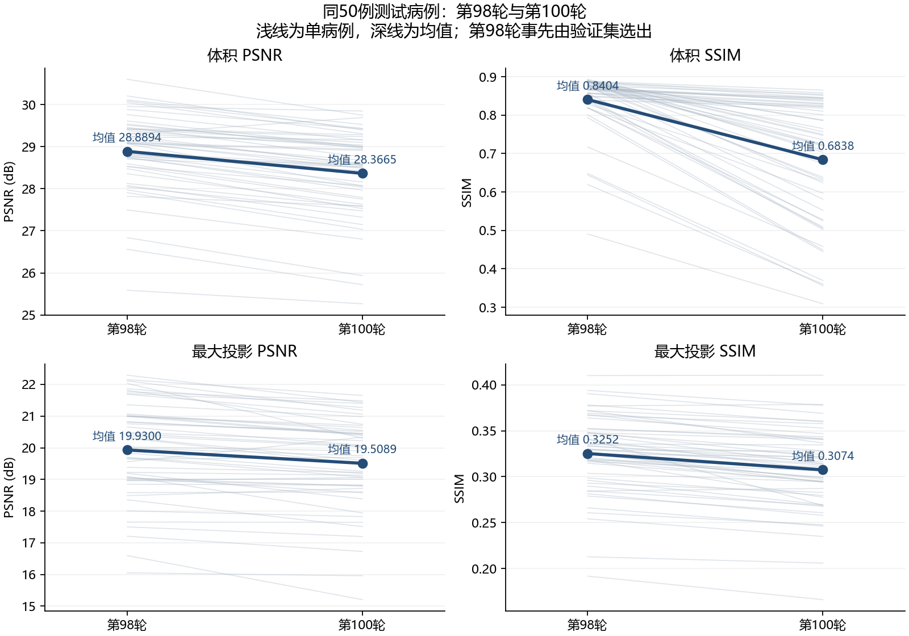
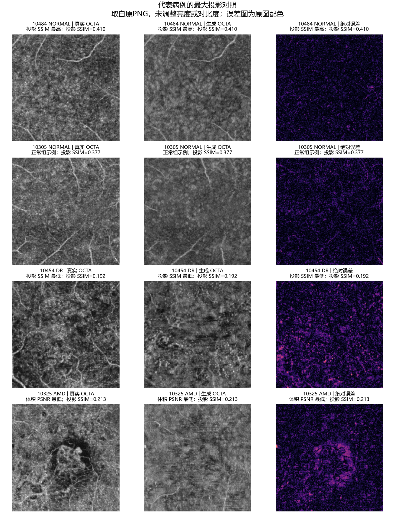
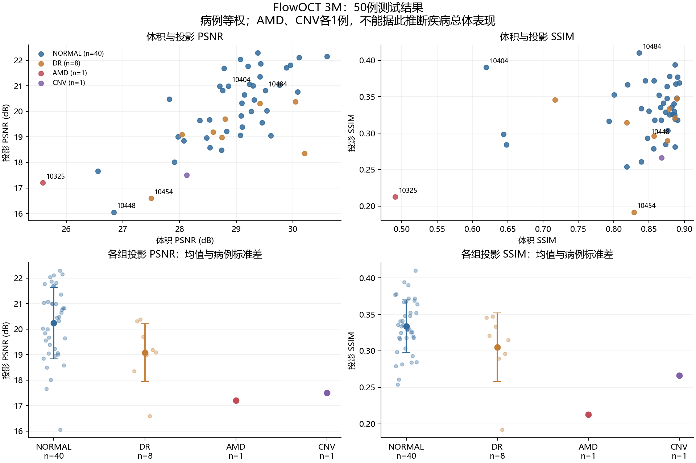

# FlowOCT 3M 中期测试分析

分析日期：2026-10-22。结论依据当前下载的前100轮训练日志、第98轮和第100轮各50例测试记录、第98轮的50张对照图，以及两套预测体积的代表病例抽查。

**投影口径补充：本报告原有的“投影”是全深度最大值投影。用户随后明确对照OCTA-500的FULL图，官方FULL采用全深度均值。已使用同一第98轮预测补算50例FULL，并对齐官方显示方向及裁剪区域，见[官方FULL投影核对与修正说明](FULL%E6%8A%95%E5%BD%B1%E6%A0%B8%E5%AF%B9%E4%B8%8E%E4%BF%AE%E6%AD%A3.md)。本报告原投影数值仍保留为最大值投影指标，不能当作官方FULL指标；以下看图结论针对原最大值投影，不直接等同于FULL或分层血管评价。**

**第98轮在当前测试集上的整体指标优于第100轮。生成图能恢复部分大血管和体积中的层状信号，主要不足是细血管纹理模糊、局部信号遗漏，以及部分异常区域的结构差异。**

## 1. 文件与统计核对

- `best_preview` 的预测记录明确保存 `checkpoint_epoch=98`，模型为 `best.pt`，其SHA256与评价文件一致。另一套记录对应 `epoch_0100.pt`，轮次为100。
- 两次测试均为同一50例，病例ID、数据清单SHA256、配置及每例裁剪/归一化记录相同，均未设置诊断病例限制。
- 第98轮逐病例CSV重算的均值、总体标准差、各疾病组统计，与汇总文件一致。50张PNG与50个病例ID全部对应。
- 两套各50份NPZ的ZIP容器均可识别。抽查10305、10454、10325、10484在两轮的预测体积，重算体积和投影MAE/PSNR，与记录的差异小于1e-10；对应两轮GT数组逐字节一致。未逐例重新计算全部体积SSIM。
- 逐病例数值全部有限。本次未改动训练代码、配置、原始指标文件或预测文件。

第98轮 checkpoint SHA256：`012d442874b2d513d23b7e41edbebcc5bad187bfa54e8f2fcbba42cf198c6aba`。

第100轮 checkpoint SHA256：`0a5768fc12fe2135c498b10b7bdfe7a77eda3fa41ed4a41a1e71b86be3c2f5cd`。

## 2. 整体测试指标

均值和标准差按病例等权计算。标准差描述病例差异，不是重复训练的波动或置信区间。MAE和SSIM无量纲，强度归一化至[0,1]；PSNR单位为dB。

| 指标 | 第98轮，均值 ± 总体标准差 | 第100轮，均值 ± 总体标准差 | 第98轮更好的病例数 |
|---|---:|---:|---:|
| 体积MAE，越低越好 | **0.01357 ± 0.00284** | 0.01716 ± 0.00388 | 50/50 |
| 体积PSNR，越高越好 | **28.8894 ± 0.9368** | 28.3665 ± 1.0180 | 49/50 |
| 体积SSIM，越高越好 | **0.8404 ± 0.0796** | 0.6838 ± 0.1596 | 50/50 |
| 最大投影MAE，越低越好 | **0.08062 ± 0.01558** | 0.08433 ± 0.01557 | 43/50 |
| 最大投影PSNR，越高越好 | **19.9300 ± 1.4895** | 19.5089 ± 1.4285 | 44/50 |
| 最大投影SSIM，越高越好 | **0.3252 ± 0.0430** | 0.3074 ± 0.0450 | 47/50 |

第98轮相对第100轮，体积MAE下降约20.93%，体积PSNR增加0.5230dB，投影PSNR增加0.4211dB，投影SSIM增加0.0178。不能将dB差值解释成相同百分比的图像质量改善。

第98轮事先由验证集平均体积PSNR选出；本次测试对比是描述该模型的结果。后续仍沿用验证集选模规则。

## 3. 看图发现与指标的关系

已按病例ID顺序查看50例最大投影的真实图与生成图，并详细查看代表病例的完整对照图。看图结论是定性观察，尚未使用血管分割标签测量连续性、血管密度或诊断准确性。

- 多例较粗血管的主要走向可以对应，例如10305、10484，但真实图中的细密血管网在生成图中变成较平滑、斑块状的纹理。这种现象也出现在投影SSIM较高的病例。
- 10454（数据标签DR）存在明显纹理和局部明暗分布差异，投影SSIM为0.1917，是本次最低；其体积SSIM仍有0.8286，说明单看体积指标不足以判断血管细节。
- 10325（数据标签AMD）的局部高对比结构没有准确恢复，体积PSNR为25.5866dB、SSIM为0.4907，均为本次最低，投影SSIM为0.2128。
- 10367（数据标签CNV）中心局部结构在生成图中表现为模糊暗区与条纹，真实图中的局部细结构对应不足。投影SSIM为0.2661。
- 10448（数据标签NORMAL）投影PSNR为16.0505dB，是本次最低。结合图像可见生成结果更暗且细密纹理减弱，不能把所有差病例都归因于疾病标签。

体积SSIM与投影SSIM分别在三维数组和二维最大投影图上计算，维度和像素分布不同，不应直接作同一标尺的数值比较。当前体积指标包含背景，投影图则更直接展示血管纹理差异。

抽查4例的真值中，精确零强度体素占比分别为71.02%、71.33%、71.95%、72.17%。这是这4例的数值统计，未外推成全部50例的占比，也不是解剖前景掩膜。以10305为例，真值为零处的预测平均强度从第100轮的0.007434降至第98轮的0.000667，说明第98轮的部分优势与更好的背景抑制有关。10325和10484在非零真值体素上的MAE反而略高于第100轮，进一步说明全体积指标改善不保证每个局部结构都改善。这些辅助观察没有替换原有正式评价协议。

## 4. 病例组成与疾病组差异

下表为第98轮。疾病名称沿用数据标签，仅分析生成误差。

| 数据标签 | 例数 | 体积PSNR | 体积SSIM | 投影PSNR | 投影SSIM |
|---|---:|---:|---:|---:|---:|
| NORMAL | 40 | 28.9852 | 0.8477 | 20.2299 | 0.3335 |
| DR | 8 | 28.9190 | 0.8440 | 19.0748 | 0.3049 |
| AMD | 1 | 25.5866 | 0.4907 | 17.2059 | 0.2128 |
| CNV | 1 | 28.1260 | 0.8678 | 17.5012 | 0.2661 |

NORMAL占80%，总体均值主要受正常病例影响。当前8例DR的体积指标接近NORMAL，投影指标较低。AMD与CNV各只有1例，记录的组内标准差为零只是因为样本量为1，不能作为稳定性证据，也不能据此推断对应疾病总体表现。当前总体均值不是各疾病组等权均值。

## 5. 对本次复现实验的判断

当前结果支持“训练和生成流程有效，部分结构得到恢复”，细血管和异常区域仍是主要短板。仅凭这一方法的一次中期测试，无法判断它是否优于其他基线；需要使用相同病例划分、预处理、测试范围和指标实现进行比较。

这些指标对应重采样后的256立方中心裁剪，以及沿物理Z轴的最大投影；不是完整原始FOV、解剖分层投影或论文前景ROI评价。它们不能直接代替论文的全部评价项目。

若继续执行已确定的复现方案，保持现有代码、损失权重和数据划分，使用`latest.pt`续训至总共200轮，并继续依据验证集体积PSNR保存最佳模型。保存本次第98轮模型及记录作为中期结果。单次第100轮回落不能证明训练已经持续过拟合，也不能保证训练至200轮必然提高指标。

如果后续研究方法改进，应先冻结这次基线结果，将改进作为独立实验；模型和超参数选择仍依据训练/验证数据。

## 6. 来源与可复核文件

- [第98轮整体和分组指标](D:/data/FSdata/evaluations/flowoct_3m_best_preview/summary.json)
- [第98轮逐病例指标](D:/data/FSdata/evaluations/flowoct_3m_best_preview/per_case.csv)
- [第98轮预测记录](D:/data/FSdata/results/flowoct_3m_best_preview/prediction.json)
- [第100轮预测记录](D:/data/FSdata/results/flowoct_3m_epoch0100_test/prediction.json)
- [前100轮训练日志](D:/data/FSdata/flowoct_3m_train.log)
- [原始50例对照图片目录](D:/data/FSdata/figures/flowoct_3m_best_preview)
- 本目录`analysis.json`记录来源文件SHA256、逐病例统计校验、两轮比较和4例原始体积抽查。两轮使用的真值在4例抽查中逐字节相同。
- 本目录`review/contact_01.png`至`contact_05.png`为按病例ID顺序排列的50例投影检查图，使用原PNG像素，未改变亮度或对比度。
