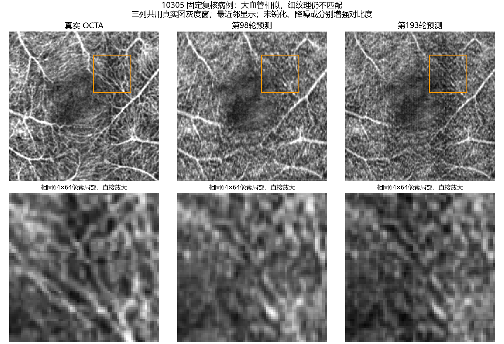

# FlowOCT：细血管模糊与高分指标的复核

日期：2026-10-25。对象：200轮预算内按验证体积PSNR选出的第193轮模型，以及此前第98轮；同一50例3M测试数据。

后续论文逐项核查补充：当前抽片/投影方向同时受到本工程ZYX到YXZ适配假设的影响，作者原始NPZ物理轴仍未确认，不能将方向差异全部归因于公开模型。另已在三例、192张训练抽片的独立重放中确认速度ROI全部回退整图。完整证据、权重展开与同类中心切片比较见[论文与实际复现逐项核查](../flowoct_paper_audit_20261025/FlowOCT_%E8%AE%BA%E6%96%87%E4%B8%8E%E5%AE%9E%E9%99%85%E5%A4%8D%E7%8E%B0%E9%80%90%E9%A1%B9%E6%A0%B8%E6%9F%A5.md)。原有数值记录不变。

**修正后的评价：目前生成了较相近的大血管分布和整体明暗，但细血管存在平滑、粘连、缺失和错位纹理，尚不能认定已达到论文展示的图像质量。此前FULL平均指标改善是真实的，但据此对复现质量作乐观评价不够充分。**

## 模糊已经存在于预测数据

直接读取未修改的二维FULL浮点数组，以相同GT灰度窗、最近邻方式显示，同一区域直接放大。没有锐化、降噪或单独优化预测对比度。固定病例10305沿用上次复核病例，不是按本次最好或最差指标挑选。

放大后，真实图中的部分细线和间隙，在预测中变宽、粘连或被不匹配的纹理替代。因此问题不仅是图片尺寸或显示清晰度；原始预测尚未准确恢复这些结构。平均投影会合并不同深度信号，但真实体积和预测体积采用同一投影方式，仍存在明显质量差距。

## 为什么原来的FULL SSIM约0.94，看起来却差很多

原体积归一化到[0,1]。沿深度取均值以后，各病例真实FULL图的实际灰度跨度只有0.0535–0.0878，平均0.0681。此前FULL SSIM继续使用固定data_range=1，PSNR也使用峰值1。

这个计算定义并非算术错误，但SSIM中的稳定常数由data_range决定。在当前窄范围投影上，固定范围1对局部细纹理误差不够敏感；投影还会抵消部分不同深度的误差。不能把0.94理解为细血管恢复了94%，也不能将FULL的41.54 dB与论文三维体积PSNR比较。

对全部50例另做范围敏感性检查：不修改任何预测或真实像素，只把SSIM和PSNR的参考范围换为该病例GT投影的max-min，其他设置相同。

| 评价定义 | 第98轮 | 第193轮 |
| --- | ---: | ---: |
| FULL SSIM，原固定范围1 | 0.9279 | 0.9395 |
| FULL SSIM，GT实际跨度敏感性检查 | 0.4213 | 0.4253 |
| FULL PSNR，原固定峰值1 / dB | 40.9105 | 41.5396 |
| FULL PSNR，GT实际跨度参考 / dB | 17.5190 | 18.1482 |

后两种范围设置是补充诊断，**不是新的论文指标、不是唯一“正确分数”，也不替换已预先确定的原评价记录**。它们表明此前高分强烈依赖评价范围，不能用一个FULL分数概括视觉质量。没有将真实图和预测图分别做min-max，亦没有裁剪预测的超窗值来改善分数。

补充将大范围明暗与细纹理分开计算相关性：低频采用sigma=3像素的高斯结果，高频采用原图减sigma=1高斯结果。滤波仅用于诊断统计，不是输出后处理。

| 50例平均相关系数 | 第98轮 | 第193轮 |
| --- | ---: | ---: |
| 大范围明暗相关 | 0.8255 | 0.8255 |
| 细纹理相关 | 0.2461 | 0.2565 |

这与“大致分布相似、细节匹配不足”一致。相关系数不是血管准确率，高频也包含噪声，不能把0.2565解释成恢复了25.65%的血管。

SSIM参数依据：[scikit-image 0.25.2官方说明](https://scikit-image.org/docs/0.25.x/api/skimage.metrics.html#skimage.metrics.structural_similarity)。本次逐例记录见projection_detail.json。

## 针对代码和插值的实际核对

1. 下载预测记录的8个核心源码SHA256与本地代码逐一匹配。正式训练network_chunk=0，推理每批32片，固定三步生成。当前结果不能归因于早期提议的network_chunk=4激活重计算方案。
2. 加载真实第193轮best.pt。对10305的Y=64、128、192三张完整256×256 B-scan，将相同输入分别送入锁定版本的作者原模型和当前封装模型。二者输出最大绝对差、平均绝对差均为0。
3. 上述输入经过四个Haar子带再逆变换，最大重建误差1.79×10⁻⁷；没有发现丢弃高频子带的情况。
4. 同一模型在本次诊断中按1片或3片生成，最大差3.43×10⁻⁷；本地重生成与保存的A100预测最大差2.04×10⁻⁴、平均差1.07×10⁻⁵。这是有限切片抽查，不是全测试集再次推理。
5. 对10305、10325两例真实OCTA，以原始640层体积直接走作者TorchIO Resize(400,400,256)，再按相同中心裁剪和min-max处理。与common数据先变成z256、再走当前加载器的结果逐体素完全一致；也与下载预测包中的真实目标逐体素完全一致。

第5项说明：在这两例上，没有发现先准备z256数据额外造成相对作者在线缩放流程的模糊。作者加载器本身就缩放最后空间轴到256，不能仅凭“原始640层变成256层”就把问题归因于适配代码。检查对象是这两例OCTA目标，没有声称重查全部病例和全部输入OCT。

本地推理抽查在RTX3060 Laptop上使用FP32，并显式关闭matmul和cuDNN的TF32，以便比较运算；这是独立诊断进程的设置，没有修改A100训练配置。它证明的是抽查切片的推理一致性，不能证明训练轨迹、作者未公开的离线处理或整套实验完全相同。

参考：[作者锁定模型代码](https://github.com/cnu-medilab/FlowOCT/blob/2309126956d2b80a95f2d307d85a50799cc658a6/models/FlowOCT_model.py)、[作者加载器](https://github.com/cnu-medilab/FlowOCT/blob/2309126956d2b80a95f2d307d85a50799cc658a6/datasets/OCTA500_dataset.py)。完整差值记录见source_execution_checks.json。

## 目前可以解释到哪一步

可以确认：模糊及错误细纹理存在于生成输出中，FULL原高分掩盖了其中一些问题；已经核对的推理封装、Haar重建和两例缩放路径没有发现足以解释明显模糊的额外误差。

仍然需要区分的训练因素包括：作者离线视网膜裁剪与输入数据分布、公开代码与论文之间的监督方式差异，以及以体积PSNR选模时对结构质量的取舍。具体而言，公开实现对抽取的Y/B-scan合并批次取max，约束的是XZ平面，并没有直接对当前查看的Z轴FULL平均图增加独立约束；二维网络也是逐B-scan生成。这个行为来自公开代码，不是本次添加，但是否构成主要成因，需要验证集上的对照实验，不能仅由当前图像下结论。

不能仅凭“像素损失权重大”断言某项支配训练。第193轮平均损失经权重相乘后，velocity约0.00864、L1约0.00957、contrast约0.01984、projection约0.00247；单看系数10、0.5、0.005、0.1并不能判断实际数值贡献，更不能等同于梯度贡献。

也没有足够证据把模糊归结为“只差训练轮数”。第98到193轮，FULL细纹理相关只从0.2461变成0.2565，体积SSIM则从0.8404降到0.8021。继续到400轮可能改变结果，但现有数据不能保证细血管必然变清楚。保留原200轮实验记录与原选模规则，对新增训练结果使用一致的验证与展示协议。

目前更准确的实验表述是：**在共同数据划分上完成作者公开二维实现的训练与测试，细血管重建与论文视觉效果仍有差距，原因尚需分项对照核实。**

## 本次改动

仅新增本目录下的独立诊断脚本、JSON、原始像素对照图和本说明。没有改训练源码、损失权重、数据划分、checkpoint、原始预测、既有评价记录或服务器实验。未用测试集重新挑选主模型，也未对预测进行锐化或降噪。
