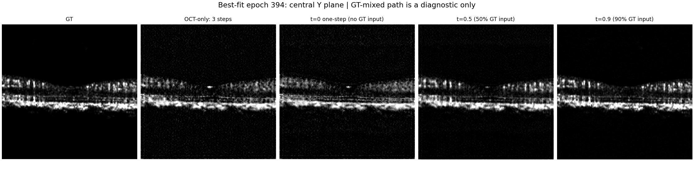

# FlowOCT 单病例拟合分析报告

研究对象：10308，固定裁剪，从零开始，400次更新。

## 01  核心结论：学到了外形，尚未重建清楚的血管

FlowOCT 固定裁剪单病例拟合审计 | 病例10308 | 400次参数更新 | 分析日期：2026-10-26

> **我的定性结论：在本次400次更新预算内，当前实现没有展示出清晰、可靠的单病例细血管重建能力。它确实在学习，但主要改善的是亮度、组织范围和低频轮廓。把这组结果评价为“已经复现得很好，只差再多跑几轮”，证据不足。**

这是一项明确但有边界的负面结论：失败的是本次预算下的精细血管拟合表现，并不是已经证明FlowOCT算法无效、模型容量不足或某一项代码错误造成了全部问题。一个病例、一个随机种子和400步训练，不能替代因果消融或充分训练证明。

| 审阅对象 | 判断 | 主要依据 |
| --- | --- | --- |
| 运行与记录 | 通过 | 400步记录连续；loss有限；输入及GT一致；选优规则正确 |
| 亮度和低频组织定位 | 有实质改善 | 70至394轮体积PSNR增加2.753 dB；FULL低频相关达到0.772 |
| 细血管结构 | 当前未达目标 | 分支断裂、粘连、颗粒状替代；394轮FULL高频相关为-0.018 |
| 对比结构监督 | 高度可疑，需验证 | 后20轮原始对比损失4.844024，贴近均匀127候选的ln(127) |
| 最佳模型的代表性 | 存在指标冲突 | 394轮体积PSNR最高，400轮投影结构指标更好 |
| 论文完整复现 | 仍未证成 | 本实验没有补齐已查明的掩膜、分层投影、条件通路和轴解释问题 |

以上是对本次结果的审阅判断，不是事后伪装成预注册数值门槛。评价“细节未达目标”同时依据原始图像和结构敏感性诊断；高通相关度本身不是血管分割准确率。

最尖锐但也最必要的评价是：目前看到的是一幅越来越像OCTA分布的灰度纹理图，而不是对这个病例血管网络的可靠重建。图像“有纹理”与血管“位置、分支、连通关系正确”，是两回事。

## 02  实验是否可信，以及“400轮”到底有多少训练

| 项目 | 实际设置 |
| --- | --- |
| 病例/划分 | 10308，NORMAL，原训练集病例；本次没有独立验证/测试集 |
| 初始化 | 全新随机初始化，seed=2026；记录声明未加载预训练权重 |
| 固定输入 | 400×400×256后中心256立方裁剪，YXZ起点[72,72,0]，不翻转 |
| 每次更新 | 随机64张Y方向B-scan，随机t，FP32，network_chunk=0 |
| 原目标 | 10×速度MSE + 0.5×L1 + 0.005×对比 + 0.1×投影；原ROI规则 |
| 完整生成 | 只输入OCT，3步Euler，每步clamp[0,1]，推理分组32 |
| 选优 | 每轮该训练裁剪完整体积PSNR最高；严格大于才更新best_fit |
| 更新预算 | 400轮=400次Adam更新；每轮同一病例曝光一次 |

完整性核验：下载包18,570,269字节，CRC通过；SHA256与服务器日志一致。原始OCT/GT体素哈希、裁剪几何、FULL、最大投影和三个中心切片，均与本地真实10308重算结果一致。不存在下载损坏或更换GT后比较的证据。

400条历史、400条日志相互一致；所存阶段与历史中的指标一致；所有历史前缀的最佳轮次均重算正确。14组投影的6项原记录指标独立重算，最大绝对差约1.26×10^-12。检查点元数据的模型状态哈希与阶段JSON一致。

> **我必须对自己设计的实验说明限制：400轮只代表400次更新，不是原140病例实验的56,000次更新。单病例仍包含256张不同B-scan，每次只抽64张；不能把它当作一张小图被训练了400个完整体积回合。**

按日志计时，真正前反向更新累计约9.02分钟，完整生成及指标计算约44.71分钟；评估占这两项记录时间的83.2%。每步评估有利于精确保留最佳，但若后续扩大更新预算，继续每步完整评估会很低效。这是本次诊断方案的成本问题，不应回避。

压缩包不含权重或完整3D预测。因此本地可以重算二维图指标、核查原始输入和记录一致性，不能独立重跑394轮网络或重新计算体积PSNR/SSIM；这些三维值仍来自服务器记录。

## 03  数字在改善，但选优并不等于选中最清楚的图

| 轮次 | 体积PSNR | 体积SSIM | FULL SSIM(1) | FULL SSIM(2) | MIP SSIM |
| --- | --- | --- | --- | --- | --- |
| 70 | 26.162 | 0.5744 | 0.8766 | 0.1238 | 0.1377 |
| 100 | 27.669 | 0.6161 | 0.9111 | 0.1419 | 0.2353 |
| 200 | 28.441 | 0.6354 | 0.9277 | 0.1793 | 0.2735 |
| 300 | 28.387 | 0.6113 | 0.9292 | 0.1703 | 0.2822 |
| 394 最佳 | 28.915 | 0.6725 | 0.9378 | 0.1923 | 0.2869 |
| 400 | 28.756 | 0.6163 | 0.9360 | 0.2364 | 0.3182 |

注：(1)FULL SSIM使用data_range=1；(2)使用该例GT投影真实跨度，属于细节敏感性诊断，不能直接与论文SSIM比较。MIP为物理Z深度最大投影，使用data_range=1。

70至394轮，体积MAE下降28.84%，FULL投影MAE下降43.36%，体积PSNR提高2.753 dB。这些是真实改进，不能说模型完全没学到东西。但这些改进没有转化成清楚的细血管分支。

> **394轮不是“所有方面最好”。400轮体积PSNR低0.159 dB、体积SSIM低0.0562，但FULL跨度SSIM从0.1923升到0.2364，MIP SSIM从0.2869升到0.3182。代码没有选错，它严格执行了体积PSNR规则；真正的问题是这个规则不能代表你的血管清晰度目标。**

完整400步历史中，体积PSNR最高为394轮；体积SSIM最高为112轮（0.7836）；FULL跨度SSIM、MIP SSIM和FULL高频相关最高均为400轮。不能只挑一列最漂亮的数字讲成“整体最佳”。

公平记录应保留394轮为预先约定的PSNR最佳，另外报告400轮的结构差异。不能看完图后悄悄改选模标准，再把新的选择冒充原规则结果。

原作者公开代码也是验证病例三维PSNR逐例平均后选优，当前复现沿用这一原则；本单病例实验只是把对象换成该训练裁剪。代码规则本身一致，不意味着论文其它结构监督已完整实现。

## 04  定性审图：问题不只是“有点糊”

图1：GT、体积PSNR最佳394轮、最终400轮。上为FULL，下为预先固定的64×64局部。共享GT亮度窗口。

GT中能够辨认的细长分支、血管交叉和狭窄暗间隙，在预测中常被灰色团块、颗粒或粘连区域代替。中央低信号范围大致能对上，但周围细血管走向没有可靠对应。70至100轮主要在校正过亮，后期仍未把“灰度接近”推进成“结构正确”。

更严重的是，394轮FULL高通标准差约为GT的0.998倍，高频相关却只有-0.018。400轮高通标准差约为GT的0.997倍，相关仍只有0.009。它并不只是少了一些高频，而是高频起伏的位置与GT几乎没有对应。颗粒感不能被当成血管细节恢复。

这个高通诊断也包含噪声，不能直接换算成血管准确率；但结合固定局部中分支不对应的视觉证据，它明确反对“纹理很多，所以细节已经很好”的解释。图边缘还可见与GT不一致的带状亮边，值得后续单独核查裁剪边界与网络边缘行为。

## 05  不能把问题全部归咎于FULL投影方式

图2：上为Z最大投影，下为中心Y方向B-scan；比较GT、394轮、400轮。

最大投影没有把被平均“藏起来”的细血管完整找回来，仍有明显斑块化和结构缺失。394轮MIP SSIM仅0.2869，400轮为0.3182。因此，“只是FULL平均投影把本来清楚的体积弄糊了”不能解释全部问题。

B-scan中，网络已经能较好找出视网膜大致位置、厚度变化和亮层分布，这解释了低频相似度和体积指标的提高。但GT中的局部血流亮点、暗间隔并未逐一可靠复现，预测还带有背景残留。当前模型更擅长回答“哪里像视网膜”，尚未可靠回答“哪里有这个病例的血管”。

这只是基于10308的定性判断，不是临床诊断，也没有做血管分割或病灶测量。不能把组织层形态较接近，直接升级成血管网络已经恢复。

## 06  训练曾明显失稳，不能只截取最后几轮说“很稳定”

图3：完整400步训练。红色区间标记236至250步的异常，不是人为删除的离群点。

| 位置 | 三维PSNR / FULL跨度SSIM | 现象 |
| --- | --- | --- |
| 227轮 | 当时历史最佳 | 此前局部记录可见的最好轮次 |
| 244轮 | 18.682 dB / 0.0219 | 完整生成质量明显下坠 |
| 245轮 | 总loss=0.31788；加权速度项=0.26407 | 总损失尖峰主要表现为速度项增大 |
| 394轮 | 28.915 dB / 0.1923 | 重新刷新体积PSNR最佳 |
| 400轮 | 28.756 dB / 0.2364 | 体积PSNR稍低，投影结构更高 |

我之前针对285至292轮说“这8轮运行稳定”，只适用于那8轮；看到完整曲线后，必须补充：整段训练并非一直平稳。244轮的质量下坠与245轮的损失尖峰不能忽略。日志中的loss是在本轮参数更新前计算，评估是在更新后进行，因此相邻一轮出现峰谷并不矛盾。

现有日志只能定位异常及其分量，不能证明根因就是梯度爆炸、学习率过大、某一批t或ROI切换。没有记录逐步梯度、采样索引/t或保存244轮权重，不能事后编造唯一解释。显存峰值持续约25.17 GiB，未见这次异常由显存逐步增长直接引起的证据。

## 07  两个最值得批判的实现问题：ROI与对比目标

图4：左为加权损失，右为原始对比损失与均匀127候选基准。

> **速度ROI在本病例上不是偶尔失效，而是必然覆盖整图：本地重算固定OCT/OCTA差值的256张速度目标，全部找不到超过亮度阈值的有效行；真实目标的边框因此返回整图，与预测框取并集后仍是整图。这个结论不依赖394轮权重或随机抽片。**

问题来自把正值图像的亮度内容检测，直接用于有正有负的速度差值OCTA-OCT。本次所谓“速度内容裁剪”实际没有实现预期的结构聚焦。它是具体、可复核的语义问题，不是“也许模型太小”一类猜测。但整图损失并不自动意味着全部误差由背景主导，本报告没有这样声称。

对比项也非常可疑：64对切片形成128个特征，每个锚点去掉自身后有127个候选。均匀打分交叉熵为ln(127)=4.844187；后20轮实际均值为4.844024，几乎一样。对应正确配对概率的几何均值约0.007875，均匀基准为0.007874。

我的批评是：这种数值不足以支撑“对比模块正在有效学习深度血管结构”的叙述。应先检查正负相似度、正确配对排名和特征方差，再谈模块贡献。现有损失值高度提示判别增益有限，但单凭标量还不能确证特征完全坍塌。

对比项约占后20轮标量总loss的49.2%，不等于占49.2%的梯度，更不证明它压制了其它损失。若没有梯度测量，不应把损失占比当作因果证据。

## 08  训练路径探针：漂亮的含GT结果不能替模型作证

图5：394轮中心B-scan。t=0.5/0.9的输入分别已含50%/90% GT，只有OCT-only列才是正式完整生成。

| t | 速度RMSE（8张） | 端点MAE | 端点MAE/(1-t) |
| --- | --- | --- | --- |
| 0.0 | 0.03670 | 0.01595 | 0.01595 |
| 0.5 | 0.03179 | 0.00767 | 0.01534 |
| 0.9 | 0.03639 | 0.00189 | 0.01893 |

当前路径是x_t=(1-t)A+tB，训练式端点为x_t+(1-t)v_hat。忽略clamp时，端点误差恰为(1-t)[v_hat-(B-A)]。因此t接近1时，端点误差会被已知因子压小；这不是网络突然把血管学会了。表中除以(1-t)仅作尺度提示，因实际有clamp，不把它当作严格反推的速度MAE。

> **t=0.9的端点很像GT，是探针最容易制造的乐观错觉。394轮t=0和t=0.9的速度RMSE分别约0.03670和0.03639，几乎同一量级；不能拿末端很清楚的图，宣称训练路径已经被精确拟合。**

同一中心Y平面，t=0单步MAE为0.01218，OCT-only三步为0.01225；两者视觉上都缺少细节。这不支持“模型原本能生成清楚，全被三步积分毁掉”的强说法。它也不能排除其它位置或其它积分设置存在误差，只能说明积分步数不是当前已证实的唯一问题。

标准Flow Matching本来就使用目标构造训练条件路径；训练时混入GT本身不是数据泄漏错误。必须区分训练路径回归与推理轨迹，这与原始Flow Matching论文的训练/生成定义一致。[资料1](https://arxiv.org/html/2210.02747v2)

## 09  可以下什么结论，哪些归因必须暂缓

| 说法 | 审阅意见 |
| --- | --- |
| “模型完全没学到” | 不成立：亮度、低频和整体误差确实明显改善 |
| “这就是清晰单病例过拟合” | 不成立：细血管对应关系仍差，高频相关接近0 |
| “只要再多跑几轮肯定清楚” | 没有依据：仍在改善不等于细节必然补齐；必须设更新预算检验 |
| “一定是参数量太小/二维网络不行” | 未证实：未做充分训练、等预算容量对照或二维单图正控制 |
| “FULL投影计算错导致全部模糊” | 当前数据不支持：投影逐元素核对正确，MIP和切片也有缺陷 |
| “原论文效果差就是这个原因” | 不能推出：本次没有因果消融，也没有复现作者完整私有数据协议 |
| “这是验证集过拟合” | 概念不适用：本次看的就是同一训练病例和裁剪 |
| “0.938 SSIM表示恢复了94%血管” | 错误解读：SSIM不是恢复比例，动态范围设置还会影响敏感性 |

FULL的GT真实跨度约0.0640，而默认SSIM使用data_range=1。394轮这个设置得到0.9378，改用GT跨度则是0.1923。两者都按各自定义计算正确；前者不能被孤立拿来说明细血管清楚，后者也不能冒充论文前景指标。

当前最有依据的方向是训练拟合不足、结构监督有效性不足及选模指标与任务目标不一致；缺少固定源条件、RDCA/投影平面和层定义不一致，是前次代码审计确认的实现差异。它们都是需要验证的候选，不能把“存在差异”写成“已经证明造成了本次模糊”。

本工程ZYX到YXZ的适配来自作者加载器尺寸注释，而非作者带物理轴信息的原始样例。这是我方适配仍需承担的未确认假设，不能把责任全部推给作者代码。当前只能确认本工程内部轴和GT投影自洽，尚未确认作者原始NPZ物理排列。

同病例历史参照中，多病例第313轮FULL跨度SSIM约0.4863，高频相关约0.2919，明显优于本次400步；但它训练了43,820步，本次只有400步。这个参照可说明当前图像还有很大差距，不能据此宣布“单病例训练更差”或“新方案破坏了模型”。

## 10  后续优先级与最终定性结论

| 优先级 | 具体检查 | 判断价值 |
| --- | --- | --- |
| 1：保留证据 | 保留394/400权重和这份原始包；维持394为约定PSNR最佳 | 防止事后挑最漂亮结果或覆盖失稳证据 |
| 2：扩大原设置更新预算 | 同一固定病例从400步延续到明确总预算，如2000步；不同时改损失/网络/步数 | 判断400步是否只是短程欠拟合；2000不是保证成功的魔法数 |
| 3：查对比模块 | 记录正负相似度、特征方差、配对排名及分项梯度；必要时做等预算关闭对比的消融 | 验证接近ln(127)究竟来自无判别特征还是其它情况 |
| 4：单独核查ROI | 在另一个明确命名的消融中，用GT内容定义区域，再计算速度误差 | 验证已确认的signed目标亮度裁剪问题；不能悄悄替换原基线 |
| 5：受控查积分/条件 | 同权重比较1/3/8步；再另做显式OCT条件或轴解释对照 | 区分轨迹误差与输入/监督问题，避免多项同时改动无法归因 |

后续若延长训练，应把评估频率设计得更经济，并预先写清最佳只在已评估轮次中选择。现有交付脚本每步都会评估，不能仅修改配置中的val_every就假定它已支持稀疏评估。若改变训练或评估外层，必须记录为新的诊断版本。此报告没有修改服务器代码或启动新实验。

> **最终判断：这次实验“运行成功、学习发生、精细血管拟合尚未成功”。目前不适合把它当作一组质量令人信服的FlowOCT对比复现结果。研究上的正确动作是核查目标是否有效并补足受控诊断，而不是用一个较高的PSNR或默认FULL SSIM掩盖结构缺陷。**

参考资料与适用边界：以下资料用于解释训练目标和指标现象；本病例的数值结论来自独立重算的下载数据，不由外部论文替代。

[资料1](https://arxiv.org/html/2210.02747v2) Lipman等，Flow Matching for Generative Modeling。支持“回归条件路径速度场”和“经ODE生成”的区分；并不替本实现的轴、损失或采样正确性背书。https://arxiv.org/html/2210.02747v2

[资料2](https://arxiv.org/html/1611.07004v3) Isola等，Image-to-Image Translation with Conditional Adversarial Networks。说明像素误差优化与锐利结构生成不等价；只能作为一般机制参考，不能据此判定本病例模糊就是MSE单独造成。https://arxiv.org/html/1611.07004v3

[资料3](https://arxiv.org/abs/1807.03748) van den Oord等，Representation Learning with Contrastive Predictive Coding。InfoNCE背景；本报告的ln(127)由当前代码候选数和交叉熵直接推导。https://arxiv.org/abs/1807.03748

[资料4](https://github.com/cnu-medilab/FlowOCT/tree/2309126956d2b80a95f2d307d85a50799cc658a6) FlowOCT作者公开代码，锁定提交2309126956d2b80a95f2d307d85a50799cc658a6；另参考本地FlowOCT论文及2026-10-25逐项审计。https://github.com/cnu-medilab/FlowOCT/tree/2309126956d2b80a95f2d307d85a50799cc658a6

## 可复查材料

原包SHA256：`05b6e2e9b1b4b2ab69724c711bd9a26add3ae97ef53e7899650aa87cd2e19a82`。

原始下载未改动；重算和报告不更新任何模型权重。完整证据见同目录analysis.json、input_verification.json、original_input_verification.json及各项CSV。
