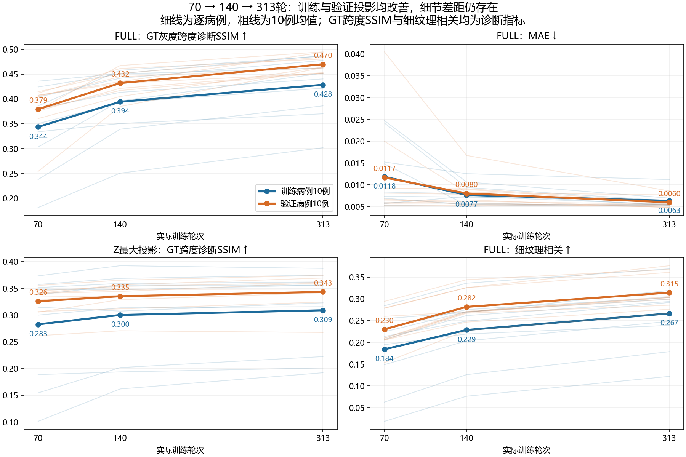
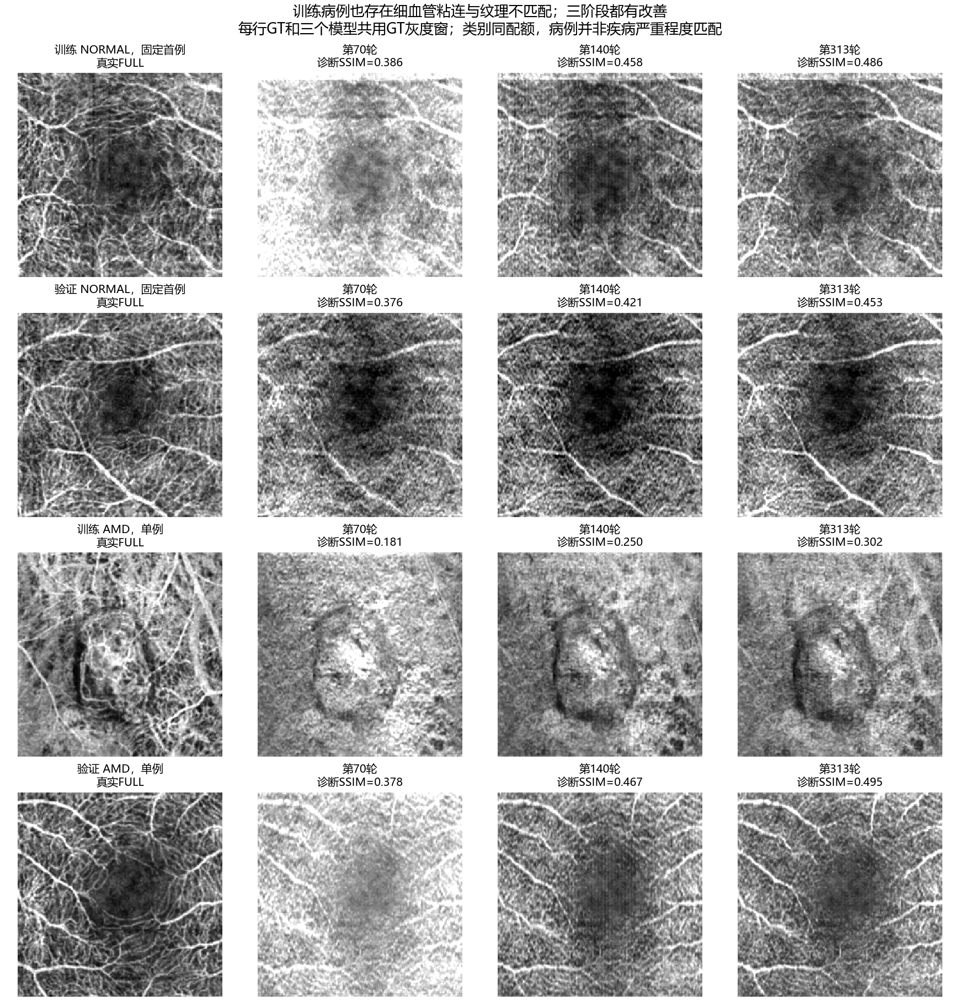

# FlowOCT：训练与验证病例的70、140、313轮投影比较

日期：2026-10-25。输入为服务器完成的固定训练10例、原验证10例，共60次病例推理与120组二维投影指标。此次没有重新训练或修改预测。

**主要结论：延长训练确实改善了这20例的FULL结构匹配，但训练病例本身也存在细血管粘连、缺失和纹理不匹配。当前结果不支持把模糊主要解释成‘训练集学得很好、只有验证集泛化差’。同时，尚不能据此将原因唯一归为欠拟合、某项损失错误或模型容量不足。**

## 1. 文件、权重与数据核对

- 原下载ZIP的SHA256为2352a755215f55b4f4e0970ae0206118a301e433aa0c49a64531530bc8891755，与用户贴出的服务器日志一致；ZIP完整性和54个解压文件内容已逐项通过核验。原ZIP在此次核验后不再位于输入目录，已保留此前核验记录及当前全部54个文件的哈希。分析脚本没有删除或移动源文件。
- 冻结记录和运行日志一致：70轮global_step=9800；140轮=19600；313轮=43820。最优采用启动时冻结的验证体积PSNR最优权重，不是在本次看完投影后重新挑选。
- 训练10例与验证10例名单、疾病标签和原始完整manifest一致，训练病例未混入验证或测试集合；两组各7例NORMAL及DR/AMD/CNV各1例。
- 原八个核心源码及导出脚本指纹与服务器记录一致；日志含顺序完整的1/60至60/60记录。三份权重文件没有放进审阅包，本地未独立重算这三份PT的哈希；目前核对的是冻结元数据、源码与运行记录。
- 120组投影指标全部从原始二维浮点数组独立重算，最大差异为7.11e-15；120条原配对差也核对一致。没有用PNG读取后重新评价。
- 额外与原训练日志核对三轮验证最大投影：MAE、PSNR均值完全一致；SSIM在转回原日志的YX方向后也完全一致。XY显示方向直接计算的SSIM只有约10^-9的浮点顺序差异，记录在validation_log_crosscheck.json。20例OCT和GT的完整体素哈希各自均无重复。
- 从本地公共z256数据重新处理全部20例：输入OCT与真实OCTA的完整体素哈希、几何、GT FULL均值图和GT最大投影均与服务器记录一致。训练病例采用中心裁剪且无翻转，三阶段输入/GT保持一致。

这些核对排除了本次包传输损坏、病例混用、GT投影算错、三阶段裁剪不一致等已检查问题；不能证明作者未公开的离线预处理和物理轴已经还原。

## 2. FULL投影随训练有明确改善

以下每个数字均为10病例等权均值。SSIM(跨度诊断)使用同一病例真实投影的max-min作为data_range，窗口7；它是此前预先确定的细节诊断口径，不是论文三维体积或foreground指标。

| 病例组 | 轮次 | FULL MAE ↓ | FULL PSNR，range=1 / dB ↑ | FULL SSIM，range=1 ↑ | FULL SSIM，跨度诊断 ↑ |
| --- | ---: | ---: | ---: | ---: | ---: |
| 训练10例 | 70 | 0.011842 | 38.3232 | 0.8749 | 0.3436 |
| 训练10例 | 140 | 0.007685 | 40.6525 | 0.9201 | 0.3942 |
| 训练10例 | 313 | 0.006332 | 42.0034 | 0.9418 | 0.4285 |
| 验证10例 | 70 | 0.011686 | 39.1669 | 0.8683 | 0.3792 |
| 验证10例 | 140 | 0.008025 | 40.7228 | 0.9064 | 0.4319 |
| 验证10例 | 313 | 0.005993 | 42.5533 | 0.9452 | 0.4699 |

- 训练FULL MAE从0.011842降到0.006332，下降46.53%；140到313轮继续下降17.60%。
- 验证FULL MAE从0.011686降到0.005993，下降48.71%；140到313轮继续下降25.31%。
- **FULL跨度诊断SSIM在20/20例上都满足70 < 140 < 313**，不是只有少数病例改善拉高均值。
- 这不等于每个指标、每个局部均改善。140到313轮，训练MAE改善8/10例，验证MAE改善9/10例；训练10354的FULL MAE上升约0.000536，验证10338上升约0.0000043，而两例结构诊断SSIM仍改善。

因此可以确认：至少在这三份权重上，更多训练有实际收益。不能继续说模糊与训练轮数完全无关；也不能从三处采样点证明每一轮单调收敛或保证400轮继续改善。

## 3. 最大投影也改善，但细节一致性仍有限

| 病例组 | 轮次 | Z最大投影 MAE ↓ | PSNR，range=1 / dB ↑ | SSIM，range=1 ↑ | SSIM，跨度诊断 ↑ |
| --- | ---: | ---: | ---: | ---: | ---: |
| 训练10例 | 70 | 0.097028 | 18.5119 | 0.2914 | 0.2827 |
| 训练10例 | 140 | 0.088688 | 19.2698 | 0.3097 | 0.3002 |
| 训练10例 | 313 | 0.084523 | 19.6212 | 0.3183 | 0.3090 |
| 验证10例 | 70 | 0.082625 | 19.7662 | 0.3371 | 0.3258 |
| 验证10例 | 140 | 0.080714 | 19.9803 | 0.3475 | 0.3352 |
| 验证10例 | 313 | 0.072247 | 20.7235 | 0.3556 | 0.3434 |

70到313轮，两组各10/10例的最大投影跨度诊断SSIM改善。140到313轮，训练改善8/10、验证改善9/10，不是所有病例的最大投影都继续改善。最大投影与FULL均值关注不同信号，不把它当作论文的分层投影或foreground评价。

## 4. 训练集为什么没有比验证集更好

第313轮，训练与验证FULL跨度诊断SSIM分别为0.4285与0.4699；FULL MAE分别为0.006332与0.005993。当前没有出现‘训练图像很清楚、验证图像明显更差’的典型模式。

但两组由不同病例组成，虽同类别配额，病变范围、信号质量和难度没有一对一匹配；不能把验证均值高于训练均值理解成验证集被拿来训练或训练失效。特别是训练AMD病例10310与验证AMD病例10456，真实图形态和难度不同，各只有1例。

作为敏感性观察，仅看各7例NORMAL，第313轮FULL跨度诊断SSIM为训练0.4610、验证0.4685，差距约0.0074；稀有病单例对总体差距有较大影响。因此不能据0.4285和0.4699直接作严格的泛化差距估计。

此外，313轮本来就是用这10例验证集的体积PSNR选择出的，验证表现存在选择因素；训练只抽查了140病例中的10例。本结果不排除其他训练区域、病例或三维指标上的过拟合。

## 5. 从图像看，细节没有被训练病例充分重建

按固定高通诊断把细纹理与大范围明暗分开，FULL结果如下。高通=图像减sigma1像素高斯，低通=sigma3像素高斯；相关性不是血管准确率，高频也包含噪声。

| 病例组 | 诊断量 | 70轮 | 140轮 | 313轮 |
| --- | --- | ---: | ---: | ---: |
| 训练10例 | 大范围明暗相关 | 0.7523 | 0.8078 | 0.8433 |
| 训练10例 | 细纹理相关 | 0.1841 | 0.2286 | 0.2666 |
| 验证10例 | 大范围明暗相关 | 0.8232 | 0.8383 | 0.8576 |
| 验证10例 | 细纹理相关 | 0.2302 | 0.2818 | 0.3145 |

训练病例313轮的大范围相关约0.843，而细纹理相关约0.267；验证对应约0.858与0.315。与图像观察一致：大血管布局和整体亮暗较接近，细线、分支和间隙仍有粘连、缺失或不匹配。不能只把高频能量足够当作细血管恢复正确。

该图按固定名单选取训练、验证的首个NORMAL，以及两组AMD单例，没有用效果选最佳病例。四列为GT、70、140、313；每行共用GT显示窗，不同病例之间亮度不可直接横比。

可具体观察：

- 训练10308：70轮明显偏亮，140轮和313轮更接近GT；局部细血管仍有宽化、粘连，部分结构没有对应上。313轮并非所有局部都优于140轮。
- 训练10310（AMD）：313轮比早期更能对应总体亮暗与中心区域，但细密网络和局部结构仍恢复不足。它是见过的训练病例，因此模糊不能只用未见病例泛化解释。
- 验证10319（NORMAL）：三阶段都保留主要血管路径；细节逐步改善，但局部仍有误差。
- 验证10456（AMD）：70轮过亮，140与313轮明显改善，313轮较接近GT。它不能与10310当成同等病情配对，也不能代表AMD整体。

完整20例和两种投影都保留在原下载目录与本次all_case_review中，没有仅展示改善病例。
本次已目视检查全部20例FULL与最大投影的三阶段总览，并检查固定病例的原像素局部放大图。

## 6. 对模糊原因的判断需要怎样更新

本次支持的结论：

1. 不是本次下载损坏、GT配错或三组使用不同中心裁剪导致的假象。上述内容已按全部20例和120指标核对。
2. 不是单纯‘训练集拟合很好、验证集失败’。见过的训练病例本身也存在端点生成细节不足。
3. 延长训练有效，但没有解决全部细节问题；70到140及140到313都能观察到改善。
4. 剩余问题可能涉及训练目标与推理端点之间的拟合差距、缺少的结构约束、当前二维组织可利用的信息，以及作者数据/物理轴假设等。当前实验没有分别操纵这些因素，不能宣布某一个已被证明是唯一原因。

此前论文核查中确认的速度ROI退化、前景/频域掩膜缺口、RDCA/分层投影方向及固定条件差异，并没有在这次比较中被修复。它们仍是需要定位的候选问题，不能因指标改善就认定无关；也不能因训练图仍模糊就直接证明其中某项导致当前结果。

下一步更有区分力的是小范围、固定裁剪的单病例拟合自检：先保持现有模型和损失，区分‘训练插值重建能够拟合’与‘仅由OCT三步生成仍不能拟合’。前者与后者不是同一条评价路径。这样可以进一步决定优先查优化/监督，还是训练到端点推理的差距，而不是同时重写全部模块。该建议尚未实施，也没有承诺改一处就一定复现论文效果。

## 7. 结果适用范围与后续记录

- 当前是训练拟合和验证集的二维投影诊断。不能当作新的独立50例测试结论，也不能将旧98/193轮测试均值与这次70/140/313验证均值直接相减当训练提升。
- 313是该次启动冻结的最优轮，不表示之后服务器best.pt没有变化；本次没有连接服务器查看之后的训练状态。
- 当前包仅保存二维投影，不能由它重算三维SSIM、深度定位、分层指标或判断每个深度的血管恢复。
- FULL跨度诊断SSIM与高通相关均为补充口径，不能把0.4285理解为恢复了42.85%的血管。range=1的高分仍原样保留，未替换原训练选模规则。
- 本次没有重新训练、修改损失或权重，也没有锐化、降噪、分别增强预测或移动源文件。

## 结果文件

- [训练与验证趋势](训练与验证_三阶段趋势.png)
- [固定训练与验证病例](固定训练验证病例_FULL对照.png)
- [训练逐例结构变化](train_逐例结构变化.png)
- [验证逐例结构变化](validation_逐例结构变化.png)
- [独立指标及全部诊断](analysis.json)
- [20例原始输入与GT核验](original_input_verification.json)
- [原训练病例图目录](D:/data/FSdata/flowoct/figures)

逐例数值表（FULL跨度诊断SSIM）：

| 组 | 病例 | 类别 | 70轮 | 140轮 | 313轮 |
| --- | --- | --- | ---: | ---: | ---: |
| 训练10例 | 10308 | NORMAL | 0.3859 | 0.4577 | 0.4863 |
| 训练10例 | 10310 | AMD | 0.1812 | 0.2504 | 0.3017 |
| 训练10例 | 10354 | NORMAL | 0.4240 | 0.4504 | 0.4623 |
| 训练10例 | 10373 | DR | 0.3338 | 0.3504 | 0.3700 |
| 训练10例 | 10386 | NORMAL | 0.3502 | 0.3929 | 0.4215 |
| 训练10例 | 10413 | NORMAL | 0.4356 | 0.4511 | 0.4872 |
| 训练10例 | 10426 | NORMAL | 0.3804 | 0.4132 | 0.4403 |
| 训练10例 | 10463 | NORMAL | 0.4037 | 0.4416 | 0.4776 |
| 训练10例 | 10474 | CNV | 0.2376 | 0.3389 | 0.3860 |
| 训练10例 | 10481 | NORMAL | 0.3031 | 0.3958 | 0.4519 |
| 验证10例 | 10302 | CNV | 0.4050 | 0.4446 | 0.4624 |
| 验证10例 | 10319 | NORMAL | 0.3756 | 0.4213 | 0.4530 |
| 验证10例 | 10338 | NORMAL | 0.4116 | 0.4613 | 0.4803 |
| 验证10例 | 10357 | NORMAL | 0.4144 | 0.4514 | 0.4842 |
| 验证10例 | 10396 | NORMAL | 0.4072 | 0.4317 | 0.4514 |
| 验证10例 | 10422 | NORMAL | 0.3787 | 0.4169 | 0.4521 |
| 验证10例 | 10447 | DR | 0.2539 | 0.3846 | 0.4630 |
| 验证10例 | 10456 | AMD | 0.3776 | 0.4673 | 0.4947 |
| 验证10例 | 10495 | NORMAL | 0.3603 | 0.4049 | 0.4643 |
| 验证10例 | 10500 | NORMAL | 0.4074 | 0.4348 | 0.4939 |
