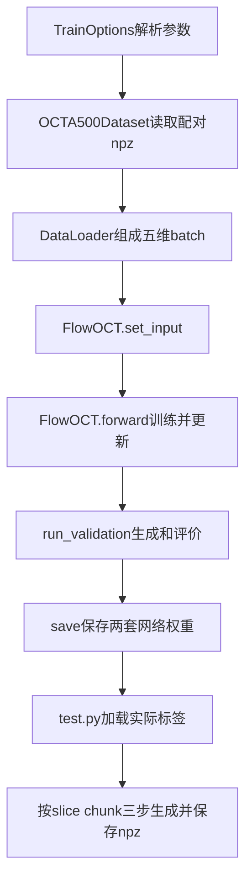

# FlowOCT 全部代码精读

本章按“一个数据样本怎样变成梯度和预测”组织。完整类/函数行号见《全部函数索引》。所有说明针对固定 commit；MONAI 内部说明针对本机 1.4.0。不要把代码注释当成已经实现的功能。

## 1. 全项目地图

作者仓库有 13 个 Python 文件，另有 README、requirements、LICENSE、.gitignore。它没有独立 `configs/`、训练 seed 管理、数据转换脚本、评价入口或测试套件。

### 文件职责

| 文件 | 职责 | 实际需要读懂的重点 |
|---|---|---|
| `train.py` | 训练总入口 | 参数→数据→模型→epoch→验证 |
| `test.py` | 结果生成入口 | checkpoint标签、eval、配对加载、输出键 |
| `visualize.py` | 三个索引平面绘图 | RESULT_DIR为空需填写，显示方向不能代替metadata |
| `datasets/OCTA500_dataset.py` | npz、resize/crop/flip/min-max | 同步变换、轴含义、常量风险 |
| `models/FlowOCT_model.py` | 模型、四损失、生成、权重 | 核心实现，优先精读 |
| `options/base_options.py` | 通用命令行、记录参数、GPU选择 | 默认不等于生效、字符串转ID |
| `options/train_options.py` | 训练专用参数 | 400epoch、Adam设置、validation频率 |
| `options/test_options.py` | 测试参数 | 默认latest并未有对应文件，save标志未控制实际行为 |
| `util/train_utils.py` | 每轮训练和验证 | 训练调用forward、患者均值、保存条件 |
| `util/util.py` | 日志和三项指标 | data_range、SSIM窗口、缺少全论文指标 |
| `util/auto_crop.py` | 求图像内容边框并裁剪 | 不是逐像素血管mask，fake/real bbox并集 |
| `util/DWT_IDWT_layer.py` | 小波滤波矩阵和模块 | 1D/2D/3D都有，主模型只用2D |
| `util/DWT_IDWT_Functions.py` | 自定义autograd | forward线性变换，backward乘转置 |

## 2. `train.py`：总入口只有组织工作

`count_parameters(model)` 遍历 parameters，累加 requires_grad 的元素数。主入口只对 `model.netG` 计数，不包括 contrast head。因此控制台的 2.33M 是生成器参数量，不是所有可训练参数总和。

`main()` 分为七段：

1. `TrainOptions().parse()` 返回一个 Namespace，属性直接作为模型/数据配置。
2. 由 `gpu_ids` 设置 device。此处默认 cuda:0，但真正设置当前 CUDA device 已在参数解析完成。
3. 强制构造 phase=`train` 与 `validation`，不是任意 `opt.phase` 自动决定二者。
4. train loader 使用 shuffle、drop_last=True；validation batch固定1。如果样本数小于batch，训练可能零更新。
5. `FlowOCT(opt)` 构造网络/optimizer。没有 `create_model` 工厂，`--model`、`--dataset_name` 不改变选择。
6. 从 epoch_count 到 n_epochs（含末轮）训练。epoch不是一次forward，是遍历完整训练loader一次。
7. 到验证频率时调用 `run_validation()` 并更新全局最好PSNR。没有scheduler、早停或定时latest保存。

`if __name__ == '__main__'` 使文件作为入口时才运行main，在 Windows多进程加载时尤其重要。

你应能解释：`num_threads` 是 DataLoader子进程数量，不是模型GPU并行数。多个gpu_ids不代表用了多卡训练。

## 3. `options/`：哪些参数真的生效

### 3.1 `BaseOptions`

- `__init__`：只设置初始化标志。
- `initialize(parser)`：注册通用参数：dataroot/name/GPU/checkpoint、通道、尺寸、batch、线程、权重标签等。
- `gather_options()`：新建parser，注册参数；先parse_known_args然后parse_args。注释提到动态模型参数收集，但这份代码没有实际进行模型工厂扩展。
- `print_options(opt)`：比较默认值，打印并存到 checkpoint/name/phase_opt.txt。调用时gpu_ids还是字符串，isTrain已经设置。
- `parse()`：加isTrain；保存参数；把'0,1'拆成非负整数；如果非空设置CUDA当前device。'-1'得到空列表。

### 3.2 `TrainOptions.initialize`

先父类注册，再增加日志频率、保存/验证频率、continue_train、epoch_count、phase、beta、n_epochs、lr，最后 `isTrain=True`。

Adam 的 `beta` 是第一矩估计系数 β1（默认0.5），不是所有优化器动量的通用定义；β2在模型里固定为0.999。learning rate默认0.0002，没有自动衰减。

### 3.3 `TestOptions.initialize`

增加 phase/test、results_dir、save_data/save_image，设置isTrain=False。当前 test.py无条件保存npz；没有根据save_data启停、也没有按save_image生成图片。不能因为命令行存在选项就认定功能实现。

## 4. `OCTA500_dataset.py`：最重要的科研风险经常在这里

### 4.1 `_make_dataset`

递归查找后缀 `.npz` 的文件；返回最多max_size条。它不会检查键、患者、配准、体尺寸。目录里的嵌套临时npz也会被读到。

### 4.2 `OCTA500Dataset.__init__`

根路径拼phase，收集并排序，存input_nc/output_nc。存下这两个参数不意味着支持任意通道；后续固定加一个channel，模型也假设C=1。

### 4.3 `_resize`

调用 TorchIO `Resize((load_size,load_size,crop_size))`。传入 `(C,D,H,W)` 后，操作三个数组空间轴，不带患者真实spacing与affine。体被重新采样，血管宽度可能改变。

### 4.4 `_get_crop_params(shape)`

训练各轴随机起点，最后一个轴随机flip；验证/测试中心crop不flip。注意_resize已令最后一轴为crop_size，那里没有随机移动余量。另外两轴是否有余量取决于load_size。load_size<crop_size时center起点可能负值，导致意外切片范围。

### 4.5 `__getitem__`

执行顺序：

1. `np.load(path)`读取oct/octa。
2. `expand_dims(axis=0)`加C。
3. 两模态分别用相同Resize目标处理。
4. 只抽一次crop/flip参数，应用到两者，保持几何同步。
5. 两者独立按当前crop的min/max缩放。
6. 转torch返回A/B与路径；DataLoader加B维。

如果一个crop刚好全背景，分母为0。数据检查体非常量也不能保证每个随机crop都非常量；正式实现需定义常量crop策略并记录。

归一化发生在crop后，改变crop会改变同一个原像素的缩放结果。当前保存的预测没有逆归一化信息，不能恢复到原始设备强度。GT normalization用于监督/评价，不是推理泄漏的网络输入，但会影响指标可比性。

### 4.6 `__len__` 与文件末尾演示

`__len__`返回体文件数。`__main__`用于单文件dataset检查，有一条作者本机旧路径注释，不是下载路径或必须使用的目录。若集合为空，`dataset[0]`会失败。

## 5. `FlowOCT_model.py`：逐函数理解

### 5.1 `name()`

返回描述字符串；训练入口不靠它选择网络。

### 5.2 `__init__(opt)`

先初始化nn.Module，保存配置/设备/目录。随后创建MONAI二维UNet，输入输出4通道。DWT/IDWT为Haar固定变换，没有学习权重。

contrast head依次是1→64的3×3卷积、ReLU、全局池化、Flatten、64→128线性层。它从单张1通道OCTA得到128维向量，不是直接读多张slice的3D encoder。

定义L1/MSE及四个固定权重；训练时Adam优化UNet和head。测试时或continue_train时，马上加载G和Contrast两个文件，即使推理只使用G仍需Contrast权重。最后设generation_steps=3。

### 5.3 `_load_checkpoint(epoch)` / `load(label)`

前者只是调用后者和打印标签。后者使用map_location加载两套state_dict，确保张量放目标device。state_dict是参数/缓冲区字典，不是完整训练状态；没有Adam和随机状态。

### 5.4 `set_input(input)`

把A/B搬device并转float32，存为real_A/real_B。数据加载可能得到float64，这里统一模型dtype。路径没有存进模型。

### 5.5 `forward()`：它包含完整优化步

这份代码的forward不仅计算网络输出，还zero_grad/backward/step。标准PyTorch项目通常把这些放外部训练循环，所以不要把此处forward的用法误推广到所有项目。

逐块读：

**A. 取shape和slice。** 解包B,C,D,H,W，N=max(1,D//4)，randperm D选N个索引；同一组索引用于batch内所有体。索引是随机顺序，不含显式深度坐标信息。

**B. 展开slice。** `permute(0,2,1,3,4)`后reshape形成M=B×N张独立图。这里丢掉了网络能直接利用的邻层排列。

**C. 路径和监督。** 每张抽一个t，广播后构造x_t和dx_t。目标由配对GT构造，不需要训练一个“目标速度模型”。

**D. 小波与网络。** DWT四带cat到通道，UNet接x_t_dwt与t，输出四带速度；IDWT恢复单通道速度。网络没有第二个输入保存最初OCT。

**E. 端点估计。** x_t+(1-t)*pred_dx，clamp到[0,1]。它是训练用估计，不调用三步generate。

**F. 损失。** 速度crop MSE、端点crop L1、head embedding对比、所有展开切片max投影L1。先zero_grad避免上一个batch的梯度累积；最后加权总loss。

**G. 梯度与参数。** `loss.backward()`沿IDWT、自定义autograd、UNet、head传播；`optimizer_G.step()`改变可训练参数。下一次forward再读取新的数据/时间。

### 5.6 `_cropped_l2_loss` / `_cropped_l1_loss`

每张图分别detach转CPU NumPy求边框；随后在**原torch张量**上用这个边框切ROI、算MSE/L1再平均。

因此并不是“detach后整个loss没梯度”。detached的是边框选择通路；ROI内强度仍可反传。边框对预测的变化不可微，且GPU→CPU同步每张都会有成本。

速度target为signed差值，未必具有OCTA正强度内容图的性质。把auto-crop直接用于速度时，阈值/max/row_means的语义需特别检查。

### 5.7 `_contrastive_loss`

令M=有效slice数量。拼fake/real为2M，L2 normalize；矩阵乘得2M×2M余弦相似度。pos_mask标记i↔i+M；neg_mask排掉自身和正对。对每个anchor，第一列是正相似度，余列为负相似度；除温度再cross_entropy，正确label都是0。

它是对称fake/real对比，负样本包括fake/real里的其它slice，和论文只对真实深度候选归一化的公式不完全一样。跨患者B>1时所有候选也混合。M=1时只有正对没有负对，CE=0。

### 5.8 投影块为什么要细看

`octa_flat.max(dim=0)`对M维取最大。B=1时是选中的N张slice的MIP；B>1时混了患者，不能解释成患者自己的投影。选中的slice t彼此不同，也不是同一时间一致生成的完整体。

`real_proj`shape为(C,H,W)，然后代码直接`fake_proj[ym:yM+1,xm:xM+1]`。这少写了通道维：第一切片作用于C，不是H；通常ym>0会取空。正确语义应保留C并裁H/W，例如`fake_proj[:,ym:yM+1,xm:xM+1]`。本次人工数据bbox覆盖全图，未触发这个错误；边框问题详见审计与已验证probe。

### 5.9 `euler_step(x_t,t_start,t_end)`

每个batch元素dt广播到4维；DWT当前状态、UNet预测、IDWT恢复v；返回x_t+dt*v。没有backward。层外generate负责clamp。

### 5.10 `generate(condition,gen_steps)`

no_grad装饰；condition作为初始状态；0→1均分；每步expand t到当前chunk batch大小，调用euler_step，clamp。传入gen_steps可以手工改变，但CLI没有直接选项，研究版应将它移到配置并记录NFE。

### 5.11 `_generate_3d(condition,chunk_size=32)`

把体排列为B,D,C,H,W并合并B×D；按32张slice分chunk，每块generate；cat后还原B,D,C,H,W再permute回B,C,D,H,W。每片仍独立，chunk只是控制计算批量，不增加深度上下文。

### 5.12 `validation()` / `test()`

validation忽略gt_image，将condition搬device后调用_generate_3d；这证明模型生成过程没有使用GT。test使用set_input已有real_A生成并存fake_B。作者test.py实际调用validation，而不是model.test()。

### 5.13 `get_current_loss()` / `save(label)`

loss方法返回OrderedDict四个原始分量`.item()`，**没有总loss与加权分量**。save确保目录存在，分别保存G与Contrast；文件标签由验证工具生成。

## 6. `auto_crop.py`：读完就能自己重写

内部 `_find_bbox(image,ratio)`：先求每行平均；阈值=max(image)×ratio；找平均超过阈值的行范围。再在这个范围求列均值，找列范围。没有有效行时返回整图；没有有效列时保留全宽。

外层分别求fake和real bbox，取并集，限制边界，上下加10像素padding；坐标为x_min,y_min,x_max,y_max，其中max是包含端点，切片要+1。

这得到**矩形内容区**，不是某根血管的mask。并集随fake变化；正式评价最好使用预先冻结的GT/解剖ROI规则，不能让预测决定自己的评分区域。

## 7. `train_utils.py`：训练与验证状态

### `run_training_epoch`

创建日志路径，tqdm遍历；epoch_iter增加batch_size，set_input后直接forward。达到print_freq才读取四项loss并写日志。

`iter_start`只在epoch开始设置，step_time用从epoch开始累计时间除batch_size，不是单个batch耗时。不要从这个字段拿推理效率结论。这个函数没有model.train()。

### `run_validation`

no_grad遍历；生成fake_B，把真/假搬CPU NumPy；MAE对全batch体计算（固定B=1）；PSNR/SSIM取[0,0]三维体。每体累加再除num，实现每体宏平均。没有model.eval()与恢复train状态。

在MONAI默认1.4.0中很多层是GroupNorm且dropout为0，因此本次未暴露明显差异；将来换BatchNorm/Dropout等，这个遗漏会改变验证行为。no_grad不等于eval。

checkpoint保存只在validation被执行的轮发生：save频率与val频率同时满足才保存current；平均PSNR超过global_best（初始0）才保存best。测试默认latest与此不匹配。

## 8. `util.py`：日志与指标

- `get_log_path`创建checkpoint/name，返回loss_log.txt。
- `log_loss`将phase、epoch、iters、时间、loss写控制台和追加文本。
- `log_metrics`记录MAE/PSNR/SSIM和验证耗时。
- `compute_mae`为全部元素绝对误差平均。
- `calculate_psnr_3d`使用skimage，data_range=GT max-min；GT非常量才可靠。
- `calculate_ssim_3d`对整个3D数组调用skimage，不是逐slice的2D平均。window_size参数没有传给skimage，实际默认窗口；此处传7恰好和默认相同，改成别的数不会生效。

没有LPIPS/FID的调用，安装了包不意味着指标已实现。`auto_crop`被导入但这些指标没有前景裁剪。

## 9. `test.py` 和 `visualize.py`

test解析参数，固定读取test，batch1、worker1；创建模型会自动load；显式model.eval；逐体生成，保存经过数据处理的输入/目标/预测。原路径取basename：嵌套目录里同名患者文件可能覆盖结果，要保证basename唯一或研究版保存完整scan_id。

visualize的`load_volume`读取三个输出键；main列出前5个npz，取三个索引中间面，排成3×3，对非第一轴图做转置，保存PNG。RESULT_DIR初始空字符串，直接运行会失败；填实际结果目录。这里的Axial/Coronal/Sagittal标签不能证明原数据确实是相应解剖方向。

## 10. 小波两文件：从线性代数读懂 autograd

### 10.1 `DWT_IDWT_layer.py`所有类

| 类 | 输入→输出 | 在主模型中是否使用 |
|---|---|---|
| DWT_1D / IDWT_1D | N,C,L↔低/高两带 | 否 |
| DWT_2D_tiny | 只返回LL | 否 |
| DWT_2D / IDWT_2D | N,C,H,W↔四频带 | 是 |
| DWT_3D / IDWT_3D | N,C,D,H,W↔八频带 | 否 |

每类的 `__init__` 从PyWavelets读取固定滤波系数；DWT用rec_lo/rec_hi，IDWT用dec_lo/dec_hi并反转。`get_matrix`以步长2排列滤波系数，生成低通L/高通H矩阵，裁边并转torch。`forward`检查维度、读输入空间长度、构建矩阵、调用相应Function.apply。

二维可写：先沿一个轴得到L与H，再沿另一个轴分成LL/LH/HL/HH。IDWT把四块乘对应转置组合回原空间。Haar偶数尺寸时重建本次误差小于5e-7。

尺寸奇数时低高带长度可能不同，不能直接cat成同形状4通道；本任务用偶数、满足UNet下采样的尺寸。

矩阵每次forward重建，没按shape/device/dtype缓存，没有注册buffer。由`torch.cuda.is_available`决定.cuda，不能跟随CPU输入、多device或混合精度。3D矩阵构建L1仅取max(H,W)，当D比二者大时可能生成不足的矩阵，需要验证，不是“类存在即可直接用”。

文件底部__main__是小波试验：多层分解，再倒序操作。变量更新会覆盖中间重建结果，不能仅凭该循环认为验证了完整多层逆变换；最后与第一级直接IDWT的对比才是简单可靠的单层检查。

### 10.2 `DWT_IDWT_Functions.py`所有Function

这个文件没有训练参数，实现自定义线性算子的forward/backward。每个forward保存所需矩阵；backward通过链式法则将上游梯度乘相应转置；固定滤波矩阵的梯度返回None。

1D DWT：y=xLᵀ，因此∂loss/∂x=∂loss/∂y·L。低/高两支相加。IDWT是x=y_L L+y_H H，梯度分别乘Lᵀ/Hᵀ。

2D DWT：LL=L0·x·L1，其它分支换成高通矩阵。backward先合并对列方向变换的梯度，再通过行方向转置回传。IDWT实现逆序组合，backward又是分解式乘法。

tiny只输出LL，因此backward只保留低频分支。3D增加一个轴，通过transpose将第三空间轴放到适合矩阵乘的位置；backward按相反顺序传播，最后返回输入梯度及若干None。

注意DWT_2D forward把矩阵临时转input.dtype，但saved矩阵和IDWT路径未统一dtype处理，AMP/float64不能未经测试就使用。本次验证的是float32 CUDA单层Haar重建和梯度，不是全部变换的所有dtype/shape组合。

文件头含Adobe及CC BY-NC-SA文字，根目录LICENSE含MIT；研究复用时保留这些来源文本。这里仅记录源文件事实，不对许可兼容性作判断。

## 11. MONAI 网络内部：不是一个神秘黑箱

本机源文件在 `D:/software/anaconda3/envs/flowoct/Lib/site-packages/monai/networks/nets/diffusion_model_unet.py`，网络结构快照见 `artifacts/monai_network.json`；[固定版本在线源码](https://github.com/Project-MONAI/MONAI/blob/1.4.0/monai/networks/nets/diffusion_model_unet.py)。

本次实例：channels=(32,64,64,64)，每级num_res_blocks=2，attention_levels=(False,False,True,True)，GroupNorm32组，with_conditioning=False。构造结果G参数2,330,180，有22个DiffusionUNetResnetBlock、11个SpatialAttentionBlock。

内部forward顺序：

1. 将 `(M,)` 的t用正弦/余弦映射为 `(M,32)`，两层MLP得到time embedding `(M,128)`。
2. conv_in将4通道映为32通道。
3. down_blocks多尺度卷积/残差、下采样，保存skip。
4. 深层middle block处理全局/较大范围关系。
5. up_blocks上采样，取对应skip组合，恢复空间分辨率。
6. GroupNorm→SiLU→输出卷积得到4通道速度系数。

对于教学16×16 wavelet输入，空间尺度大致16→8→4→2，再上采样返回16。默认256原图对应128wavelet输入，深层attention仍可能有显著token成本。

time embedding注入残差块，使同一x在不同t得到不同速度。Self-attention利用当前状态的空间关系；with_conditioning=False意味着没有通过context输入源OCT。U-Net有attention并不意味着它就是纯DiT。

网络输出卷积采用zero初始化，初始速度接近0；这解释了初期生成可能主要保留输入OCT，需要训练后才开始转换。

## 12. 新增教学工具也要能解释

| 工具 | 算法/输入输出 | 不能据它声称什么 |
|---|---|---|
| make_demo_data | 确定seed创建人工结构/管状目标npz | 真实OCTA数据、临床有效性 |
| run_upstream_smoke | 子进程运行原train/test并查产物 | 论文数值复现 |
| pack_pair | 文件夹自然排序/读取npy、显式transpose、记录metadata | 自动配准、自动解剖轴识别 |
| check_dataset | 格式/有限值/完全重复/清单患者split检查 | 近重复、清单覆盖、注册质量 |
| evaluate_results | 明确range1/window7、GT阈值示范前景、CSV | 论文完整foreground、LPIPS/FID协议 |
| visualize_results | 三个索引平面、预测/GT/误差 | 自动解剖定位 |
| 01_tensor_and_flow | 手算插值/维度/参数梯度 | 训练真实生成器 |
| 02_wavelet_and_gradient | 原Haar重建和已知解析梯度比对 | 所有小波实现都无bug |
| 03_minimal_3d_fm | Conv3d/time/skip的小UNet学习一个16³体 | 医学baseline或泛化性能 |

建议读完每个工具，口述“输入、关键变换、输出、失效条件”四句话。能做到这一点，就开始具备独立搭科研代码的能力。
