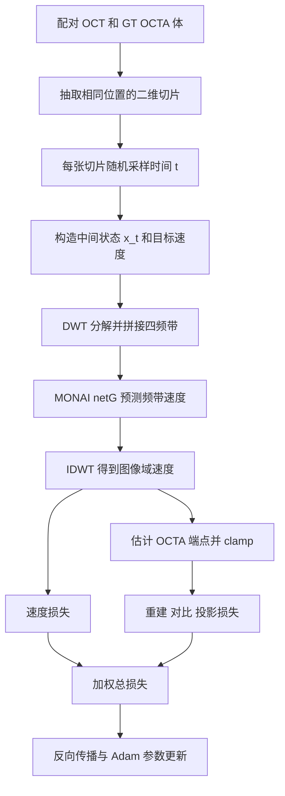
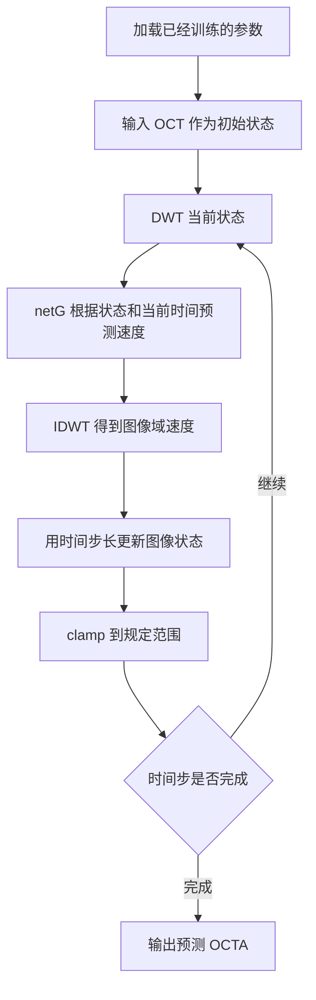
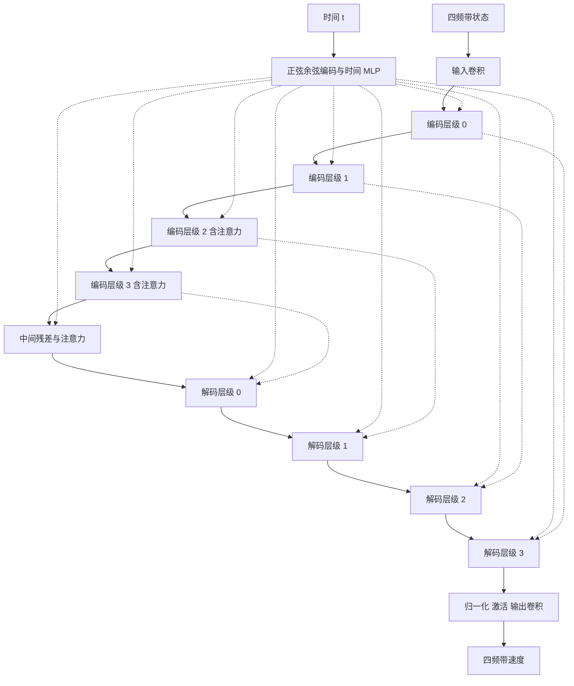

# FlowOCT_model.py 详解：先看组件怎样连接，再读 MONAI 与小波底层

更新：2026-10-03。

本文围绕一个问题展开：**一份 OCT 数据怎样经过各个组件，变成训练梯度；训练好的参数又怎样把新的 OCT 变成预测 OCTA？**

讲解依据是本地作者公开版本 `2309126956d2b80a95f2d307d85a50799cc658a6`、仅修复投影 ROI 索引的工作副本，以及当前 `flowoct` 环境中的 MONAI 1.4.0 / PyTorch 2.5.1。说明的是这些代码实际执行的行为，不能将论文中描述但未在公开版本完整实现的设计直接填入代码解释。

主要文件：

- [作者原始 FlowOCT_model.py](../upstream/models/FlowOCT_model.py)
- [建议对照阅读的修正版 FlowOCT_model.py](../working/models/FlowOCT_model.py)
- [本机 MONAI 的 DiffusionModelUNet 源码](D:/software/anaconda3/envs/flowoct/Lib/site-packages/monai/networks/nets/diffusion_model_unet.py)
- [小波层 DWT_IDWT_layer.py](../working/util/DWT_IDWT_layer.py)
- [小波自动求导函数 DWT_IDWT_Functions.py](../working/util/DWT_IDWT_Functions.py)

本次另做了一次小尺寸前向追踪，核实网络各层形状、Haar 数值例子和重建误差，记录在 [model_connection_probe.json](D:/data/code/keyan_fuxian/FlowOCT/artifacts/model_connection_probe.json)。这是教学组件验证，不是新的真实数据训练或论文结果。

## 1. 阅读时先分成三层

第一层看整体连接：数据、状态、小波、网络、损失、更新、生成。读完第 2–12 节，你应能画出训练与推理两条路径。

第二层看主网络内部：时间嵌入、残差块、下采样、跳跃连接、注意力、输出。读第 13 节，不必立即展开所有通用库函数。

第三层看小波底层：低频/高频、矩阵乘法、逆变换、梯度。读第 14–15 节，用一个 2×2 例子理解，再对照函数。

遇到复杂函数，先回答三个问题：它接收什么？返回什么？谁使用返回值？这三个问题清楚后，再看实现细节。

## 2. FlowOCT 是一个组织各组件的模型对象

源码 [第 18 行](D:/data/code/keyan_fuxian/FlowOCT/working/models/FlowOCT_model.py:18)：

```python
class FlowOCT(nn.Module):
```

它继承 PyTorch 的 `nn.Module`。这里的 `FlowOCT` 包含的不只是一个神经网络，还包括训练步骤、生成方法、损失和保存逻辑。

`self.netG` 才是主要的速度预测网络。

| 对象 | 作用 | 有训练参数吗 | 生成时使用吗 |
|---|---|---|---|
| `netG` | 根据当前状态和时间预测四个频带的速度 | 有 | 有 |
| `dwt_2d` | 图像域转为四个小波频带 | 没有 | 有 |
| `idwt_2d` | 四频带转回图像域 | 没有 | 有 |
| `contrast_projection_head` | 图像转为 128 维特征，供对比损失使用 | 有 | 没有 |
| `criterionL1 / criterionL2` | 计算绝对误差/平方误差 | 没有 | 没有 |
| `optimizer_G` | 根据梯度修改参数 | 管理参数和优化状态 | 没有 |
| `real_A / real_B` | 当前批次的 OCT / GT OCTA | 是数据，不是模型参数 | 生成使用 OCT；GT 用于训练/评价 |

`self` 指当前对象。`self.netG`、`self.real_A` 是挂在该对象上的属性；下一次调用其他方法时仍可访问它们。

`opt` 是已解析的配置对象，例如 `opt.lr` 是学习率、`opt.isTrain` 表示当前入口是训练还是测试。

注意：`self.isTrain` 与 PyTorch 的 `model.training` 是两个不同状态。前者是作者保存的配置标记，后者由 `model.train()` / `model.eval()` 控制，二者不会自动同步。

## 3. 两条总路径：先把它们分开

### 3.1 训练路径



### 3.2 生成路径



训练更新网络参数；生成更新当前图像状态。这是理解本文件最重要的区分。

## 4. 外部脚本怎样调用这个对象

### 4.1 训练入口的真实调用链

可对照 [train.py](../working/train.py) 和 [train_utils.py](../working/util/train_utils.py)。

```text
train.py
  -> TrainOptions().parse()
  -> OCTA500Dataset / DataLoader
  -> model = FlowOCT(opt)
  -> 每个 epoch 调用 run_training_epoch(...)
       -> 每个 batch 调用 model.set_input(data)
       -> model.forward()
          -> 内部完成 loss.backward() 和 optimizer.step()
  -> 指定 epoch 调用 run_validation(...)
       -> model.validation(condition=real_A, gt_image=real_B)
       -> 在生成结果与 GT 之间计算指标
       -> model.save(label)
```

`epoch` 是遍历训练加载器的一轮；`batch` 是一次取出的一组数据；`optimizer.step()` 是一次参数更新。当前代码每个训练 batch 执行一次参数更新。

### 4.2 测试入口的真实调用链

可对照 [test.py](../working/test.py)。

```text
TestOptions().parse()
  -> FlowOCT(opt)，构造时加载指定标签的权重
  -> model.eval()
  -> model.validation(condition=real_A, gt_image=None)
  -> 保存预测、GT 与 OCT 到 npz
```

特别注意：当前 `test.py` 实际调用 `validation()`，并没有调用类里的 `test()` 方法。方法名字与脚本阶段不能简单一一对应。

`validation()` 虽然有 `gt_image` 参数，但函数体没有使用它。生成结果不需要 GT；验证循环另外使用 GT 计算指标。

不过，当前公开测试脚本和数据加载器仍读取成对数据，并保存 `octa_gt`。如果部署时只有 OCT，需要改造输入加载与输出保存入口；这与“生成网络是否需要 GT”是不同问题。

### 4.3 三维体怎样进入模型

[OCTA500_dataset.py](../working/datasets/OCTA500_dataset.py) 从 `.npz` 读取 `oct` 和 `octa` 三维数组，分别增加通道维，做配对 resize、裁剪/翻转和各自 min-max 归一化。

```text
单个数组              (D,H,W)
单个 Dataset 样本      (1,D,H,W)
DataLoader 增加批次维  (B,1,D,H,W)
```

这里的 D 是第三个张量维度对应的空间轴，不自动等于视网膜的解剖深度。需由原数据元信息确认轴含义。OCT 与 OCTA 是两个独立张量，都为单通道，并没有默认拼成两个输入通道。

常量数组的 min-max 分母会为零，这是当前数据处理需要排查的数值情况。

## 5. __init__：准备组件，而不是训练一次

源码 [第 22 行](D:/data/code/keyan_fuxian/FlowOCT/working/models/FlowOCT_model.py:22)。

### 5.1 设备和路径

```python
self.device = torch.device(f'cuda:{opt.gpu_ids[0]}') if opt.gpu_ids else torch.device('cpu')
self.isTrain = opt.isTrain
self.save_dir = os.path.join(opt.checkpoints_dir, opt.name)
```

这段决定张量/网络在哪个设备上运算，以及参数文件存在哪里；没有更新参数。

### 5.2 创建主网络

```python
self.netG = DiffusionModelUNet(
    spatial_dims=2,
    in_channels=4,
    out_channels=4,
).to(self.device)
```

- `spatial_dims=2`：对 H、W 做二维空间建模。
- `in_channels=4`：接收拼接后的 LL、LH、HL、HH。
- `out_channels=4`：输出四个频带的速度预测。
- `.to(self.device)`：把网络的参数和已注册缓冲区移到设备上。

创建网络通常会初始化参数。当前默认新训练入口并不自动获得预训练权重；是否加载旧权重由后面的条件决定。

### 5.3 创建固定小波算子

```python
self.dwt_2d = DWT_2D('haar')
self.idwt_2d = IDWT_2D('haar')
```

`haar` 指选定的滤波器。这里的 DWT/IDWT 没有待学习参数。它们改变表示和传递梯度，而不是自己学习血管特征。

### 5.4 创建对比学习特征头

```python
self.contrast_projection_head = nn.Sequential(
    nn.Conv2d(1, 64, 3, padding=1),
    nn.ReLU(),
    nn.AdaptiveAvgPool2d((1, 1)),
    nn.Flatten(),
    nn.Linear(64, 128),
).to(self.device)
```

对 M 张单通道图像：

```text
(M,1,H,W) -> (M,64,H,W) -> (M,64,1,1)
          -> (M,64) -> (M,128)
```

这个头把整张图变成特征向量，供训练时比较预测/GT；它不负责生成最终图像，也不是 MONAI 主干中对 OCT 的条件编码器。

### 5.5 优化器更新谁

```python
params = list(self.netG.parameters()) + list(self.contrast_projection_head.parameters())
self.optimizer_G = torch.optim.Adam(params, lr=opt.lr, betas=(opt.beta, 0.999))
```

Adam 管理的是主网络和特征头的参数。当前源码中两者一起优化。DWT/IDWT 没有参数加入这份列表。

优化器只在 `self.isTrain` 为真时创建。因此不要在测试对象上调用训练用的 `forward()`；它会尝试使用不存在的优化器。

### 5.6 加载条件

```python
if not self.isTrain or opt.continue_train:
    self._load_checkpoint(opt.epoch)
self.generation_steps = 3
```

测试入口或配置为继续训练时加载权重。`generation_steps=3` 是默认生成步数，不是训练只更新三次。

## 6. set_input 与变量字典

源码 [第 75 行](D:/data/code/keyan_fuxian/FlowOCT/working/models/FlowOCT_model.py:75)：

```python
self.real_A = input['A'].to(self.device, dtype=torch.float)
self.real_B = input['B'].to(self.device, dtype=torch.float)
```

它搬运数据并转换成 float32，没有执行预测或参数更新。

为避免代码中的字母反复换含义，本文统一采用：

| 本文符号 | 代码对应 | 含义 |
|---|---|---|
| a | `oct_flat` | 源 OCT 切片 |
| y | `octa_flat` | 配对 GT OCTA 切片 |
| B | `self.real_A.shape[0]` | 体数据批次大小 |
| C | `self.real_A.shape[1]` | 通道数；当前流程为 1 |
| D | `self.real_A.shape[2]` | 选定空间轴上的切片数 |
| N | `num_slices` | 每个体这次抽取的切片数 |
| M | `B*N` | 展开后送入二维网络的样本数 |
| t | `t` | 流路径位置，训练时每张切片随机采样 |
| x_t | `x_t` | 训练中按真实配对构造的中间状态 |
| u | `dx_t` | 目标速度 `y-a` |
| 预测频带速度 | `pred_dx_dwt` | 主网络的四通道输出 |
| 预测图像速度 | `pred_dx` | 逆小波后的速度 |
| 预测端点 | `pred_octa_flat` | 训练中由当前状态和预测速度估计的 OCTA |

尤其注意：`dx_t` 不是代码计算出的有限时间差分；这里将它用于表示解析目标导数。它的单位可以理解为每单位归一化流时间的强度变化。

## 7. forward 上半段：三维体怎样变成二维训练样本

源码 [第 111 行](D:/data/code/keyan_fuxian/FlowOCT/working/models/FlowOCT_model.py:111)。

```python
B, C, D, H, W = self.real_A.shape
num_slices = max(1, D // 4)
indices = torch.randperm(D, device=self.device)[:num_slices]
oct_slices = self.real_A[:, :, indices, :, :]
octa_slices = self.real_B[:, :, indices, :, :]
```

`randperm(D)` 返回 D 个不同索引的随机排列，再取前 N 个。这一次抽样没有重复索引。两个模态使用相同索引，保证切片仍成对。

当 B 大于 1 时，当前代码所有体共用这一组索引。每个 batch 会重新抽样。

举例：输入为 `(1,1,256,256,256)`，则 N=64，抽取结果为 `(1,1,64,256,256)`。

接着：

```python
oct_flat = oct_slices.permute(0, 2, 1, 3, 4).reshape(-1, C, H, W)
```

逐步拆开：

```text
(B,C,N,H,W)
  -> permute 后 (B,N,C,H,W)
  -> reshape 后 (B*N,C,H,W)
```

`permute` 重排轴，`reshape` 将批次与切片两个维度合并；`-1` 让框架推算该维长度。

例子得到 `(64,1,256,256)`。这 64 个是一个体中的二维切片，并非 64 位患者。

如果 B=2、D=256，则展开后 M=128。这会影响对比损失和后面的投影计算。

### 7.1 随机时间与广播

```python
t = torch.rand(oct_flat.shape[0], device=self.device)
t_img = t.view(-1, 1, 1, 1)
```

`t` 的形状是 `(M,)`，供时间嵌入使用；`t_img` 是 `(M,1,1,1)`，供图像逐元素运算时广播使用。

同一张切片的所有像素共享同一个 t，不同切片一般获得不同 t。M=64 不表示推理做了 64 个时间步。

### 7.2 构造中间状态和目标速度

```python
x_t = (1 - t_img) * oct_flat + t_img * octa_flat
dx_t = octa_flat - oct_flat
```

对一份固定配对：

\[
x_t=(1-t)a+ty=a+t(y-a),\qquad
u=\frac{dx_t}{dt}=y-a.
\]

训练时知道 a、y，所以可以在这条线段上抽取一个状态，并获得该配对的目标速度。

单像素例子：a=0.2、y=0.8、t=0.25，则 x_t=0.35，目标速度 u=0.6。

一次参数更新并不需要先完整积分一条轨迹：当前 batch 只抽一批 t，做一次网络预测，计算损失并更新。后续 batch 继续抽不同配对、位置和 t。

对这份配对 u 不随 t 改变，但网络面对很多配对，仍是状态和时间的函数。不能由此认为所有图像共用一个常数速度，也不能保证学到的速度在每个状态上都等于当前配对的理想导数。

## 8. forward 中间段：DWT、netG、IDWT 怎样连接

源码 [第 134 行附近](D:/data/code/keyan_fuxian/FlowOCT/working/models/FlowOCT_model.py:134)。

```python
LL, LH, HL, HH = self.dwt_2d(x_t)
x_t_dwt = torch.cat([LL, LH, HL, HH], dim=1)
pred_dx_dwt = self.netG(x_t_dwt, t)
pred_dx = self.idwt_2d(
    pred_dx_dwt[:, 0:1], pred_dx_dwt[:, 1:2],
    pred_dx_dwt[:, 2:3], pred_dx_dwt[:, 3:4],
)
```

对当前 Haar 偶数尺寸路径：

| 变量 | 一般形状 | 256×256 教学例子 |
|---|---|---|
| `x_t` | `(M,1,H,W)` | `(64,1,256,256)` |
| 每一个频带 | `(M,1,H/2,W/2)` | `(64,1,128,128)` |
| `x_t_dwt` | `(M,4,H/2,W/2)` | `(64,4,128,128)` |
| `pred_dx_dwt` | 与网络输入空间形状相同 | `(64,4,128,128)` |
| `pred_dx` | `(M,1,H,W)` | `(64,1,256,256)` |

这一大尺寸例子用于推导形状，并非本次实际执行的显存测试。

`torch.cat(..., dim=1)` 沿通道维拼接；每个频带成为一个输入通道。

`[:,0:1]` 保留长度为 1 的通道轴。若写成 `[:,0]`，会去掉该轴，无法按相同接口送给 IDWT。

最关键的是：**网络输出是四频带的速度，不是四频带的 OCTA 成图。逆变换后依然是速度。**

为何能对速度做逆变换？固定小波变换是线性算子 W，因而：

\[
\frac{dW(x_t)}{dt}=W\left(\frac{dx_t}{dt}\right).
\]

但当前源码并没有直接计算 `MSE(pred_dx_dwt, DWT(dx_t))`，而是在 IDWT 之后，计算图像域裁剪速度损失。局部 ROI 和其他辅助损失存在时，不能把这两种训练目标无条件视为同一个实现。

### 8.1 四频带不是四个独立网络

它们拼接后一起进入一个 U-Net，卷积可以混合通道信息。四通道输出由统一主干产生。

### 8.2 小波没有自动丢掉四分之三的信息

单个频带面积是原图的四分之一，但保留四个频带后元素总数仍为：

\[
4\times(H/2)\times(W/2)=H\times W.
\]

完整 Haar 分解和匹配逆变换可以重建输入。只保留 LL 才会丢失高频信息。最终是否提高速度/质量仍需实测，不能仅由尺寸减半推断。

## 9. 训练中的端点估计怎样得到

源码 [第 146 行附近](D:/data/code/keyan_fuxian/FlowOCT/working/models/FlowOCT_model.py:146)：

```python
pred_octa_flat = x_t + (1 - t_img) * pred_dx
pred_octa_flat = torch.clamp(pred_octa_flat, 0, 1)
```

理想情况下预测速度等于 y-a，则：

\[
x_t+(1-t)(y-a)
=(1-t)a+ty+(1-t)y-(1-t)a=y.
\]

所以它尝试用当前位置、剩余时间和预测速度估计终点。

前面的数值例子：x_t=0.35、t=0.25、理想速度=0.6，则预测端点是 0.35+0.75×0.6=0.8。

如果预测速度为 0.5，端点为 0.725，之后可以与 GT=0.8 计算重建误差。

这一步是训练中的端点估计，没有执行默认三步生成，也没有让模型先完整生成一份 OCTA 再计算全部训练损失。它从由 a、y 构造的 x_t 出发，和部署时只从 OCT 出发的生成过程不同。

`clamp` 将端点限制到 [0,1]。输出速度本身允许正负：某些像素需要增强，某些需要减弱。小波系数也允许超出 [0,1]，不能把中间系数当成归一化图像随意裁剪。

`clamp` 在区间外对输入的梯度为零，会影响辅助图像损失的梯度；未 clamp 的速度仍接受速度损失监督。端点表达式中，速度通向端点的梯度还乘以 `(1-t)`，靠近 t=1 时这条监督链会减弱。

## 10. 四项损失：每一项到底监督什么

总损失位于 [第 179 行](D:/data/code/keyan_fuxian/FlowOCT/working/models/FlowOCT_model.py:179)：

\[
L=10L_v+0.5L_{rec}+0.005L_{contrast}+0.1L_{proj}.
\]

这些是当前代码里的默认权重，不能直接当成论文所有实验的精确配置。

### 10.1 速度损失：先监督方向和变化量

```python
self.vloss = self._cropped_l2_loss(pred_dx, dx_t)
```

比较预测速度与目标 `y-a`。当前为每张切片先找矩形 ROI，在 ROI 内计算平均平方误差，再平均各切片损失。

两层平均应分清：每张 ROI 内像素平均，然后各切片等权平均；不等于把所有 ROI 像素拼在一起平均。

### 10.2 重建损失：监督训练端点

```python
self.L1loss = self._cropped_l1_loss(pred_octa_flat, octa_flat)
```

比较估计的端点图像和 GT OCTA，使用裁剪 ROI 内 L1。这里监督的是已经 clamp 的端点，不是 `pred_dx_dwt`。

### 10.3 自动裁剪究竟做了什么

函数源码见 [auto_crop.py](../working/util/auto_crop.py)，调用见 [_cropped_l2_loss](D:/data/code/keyan_fuxian/FlowOCT/working/models/FlowOCT_model.py:189) 和 [_cropped_l1_loss](D:/data/code/keyan_fuxian/FlowOCT/working/models/FlowOCT_model.py:204)。

它根据行均值、列均值及 `max(image)*0.05` 检测内容范围，分别求预测与目标的框，再取并集，上下各扩展最多 10 个像素。没有检测到有效行时会返回整个图像范围。

这是去黑边的矩形启发式，不是逐像素血管标注，也没有在当前函数中读取视网膜层边界。

计算 bbox 时：

```python
pred[i].detach().cpu().numpy().squeeze(0)
```

`detach` 暂时切断该数组与自动求导的联系，CPU NumPy 用于决定整数坐标。随后算损失时，使用的是原始 PyTorch 张量：

```python
pred[i, :, ym:yM+1, xm:xM+1]
```

因此被选中像素仍会收到梯度，但 bbox 坐标选择本身不可微。

速度目标 `y-a` 可能带负号；用原本面向 OCTA 亮度设计的去黑边规则找速度 ROI，未必对应想监督的血管区域。这是解释实际实现时需要保留的区别。

### 10.4 对比损失：配对特征靠近，其他特征作负例

源码 [_contrastive_loss 第 219 行](D:/data/code/keyan_fuxian/FlowOCT/working/models/FlowOCT_model.py:219)。

先通过特征头得到：

```text
feat_fake = head(预测端点) -> (M,128)
feat_real = head(GT OCTA)  -> (M,128)
```

然后拼接为 `(2M,128)`，沿特征维做 L2 归一化，用矩阵乘法得到 `(2M,2M)` 的相似度矩阵。

第 i 个预测特征与第 i 个 GT 特征是正例，对应拼接后索引 i 与 i+M。自身相似度被排除；除此之外的其他特征作为负例。两个方向都参与计算。

对每个锚点，将正例相似度放在 logits 第 0 列，其他负例放在后续列，再除以 temperature=0.1。标签全部为零的含义是“选第 0 列的正例”，不是所有患者属于疾病类别 0。

源码此函数将 `feat_fake.shape[0]` 命名为 D，但这里实际是本文的 M，即展开后的切片样本数，不是原体数据的 D 轴长度。

M=2 时有 4 个特征，每个锚点有 1 个正例、2 个负例；logits 为 `(4,3)`。M=1 时没有负例，单列交叉熵为 0，这项监督会退化。

负例可能来自同一患者的其他相邻切片，不自动等于不同患者；可能存在结构相似的负例。当前实现没有根据患者身份进一步筛选。

特征头两条分支都会更新其参数；主网络通过预测端点分支收到梯度，GT 图像本身不是需要优化的参数。

### 10.5 投影损失：沿展开样本维取最大值

```python
real_proj = octa_flat.max(dim=0)[0]
fake_proj = pred_octa_flat.max(dim=0)[0]
```

输入是 `(M,1,H,W)`，结果是 `(1,H,W)`。`[0]` 从 `max` 返回的“最大值、索引”中取最大值。

当 B=1，M=N，它将本次随机选中的切片按像素取最大值。当 B>1，它会把不同体的切片一起取最大值，因为患者维已经并入 M。

所以这段不能直接解释为“每个患者完整体上的解剖层 OCTA 投影”：它只使用抽样切片，空间轴需要核实，且训练端点来自各切片不同 t 的估计。

取最大值也会影响梯度：每个像素位置主要通过选中的最大值来源回传，而不是每张切片同样收到投影梯度。

随后函数找投影 ROI，并在该 ROI 内计算 L1。

作者原件的投影 ROI 索引遗漏了通道维：

```python
fake_proj[ym:yM+1, xm:xM+1]
```

对 `(1,H,W)`，第一个范围错误地切在长度为 1 的通道轴上；例如 ym=4 时为空，会出现 NaN。

工作副本的对应两处改为：

```python
fake_proj[:, ym:yM+1, xm:xM+1]
real_proj[:, ym:yM+1, xm:xM+1]
```

对照 [原件第 173 行](D:/data/code/keyan_fuxian/FlowOCT/upstream/models/FlowOCT_model.py:173) 与 [修正版第 173 行](D:/data/code/keyan_fuxian/FlowOCT/working/models/FlowOCT_model.py:173)。这只修正索引，没有同时改变上述抽样/跨患者投影行为。

## 11. backward 与 step：梯度怎样穿过组件

源码 [第 186 行](D:/data/code/keyan_fuxian/FlowOCT/working/models/FlowOCT_model.py:186)：

```python
self.loss.backward()
self.optimizer_G.step()
```

本函数前面已经调用 `zero_grad()`。三者的作用分别是：

1. `zero_grad()` 清理上一批次积累的参数梯度。
2. `backward()` 沿计算图求总损失对参数的导数。
3. `step()` 用梯度和 Adam 状态更新参数。

主干梯度链可以读作：

```text
速度损失 --------------------------> pred_dx
重建/对比/投影损失 -> 预测端点 ------> pred_dx
pred_dx -> IDWT 的导数 -> 频带速度 -> netG 参数

对比损失 -> 特征头的两条分支 -> 特征头参数
```

“IDWT 没有参数”不表示“IDWT 不能反向传播”。它需要将输出梯度转换成对四频带输入的梯度，主网络才能学习。

当前 `x_t` 通常由不要求梯度的原始数据构成，所以输入侧 DWT 不一定需要在这条训练链上执行 backward；输出侧 IDWT 则位于可学习网络与损失之间，是重要梯度桥梁。

这个类的 `forward()` 没有返回预测，而是直接训练并更新，返回值为 None。不要在外面再加一次 `optimizer.step()`，也不要为了获得测试预测调用它。

普通 `nn.Module` 中“forward 只算输出”的习惯在这里不适用。调用 `model()` 也会通过该 forward 进入训练流程。

## 12. generate 与 _generate_3d：固定参数怎样生成图像

### 12.1 单步 Euler

源码 [euler_step 第 81 行](D:/data/code/keyan_fuxian/FlowOCT/working/models/FlowOCT_model.py:81)：

```python
delta_t = (t_end - t_start).view(-1, 1, 1, 1)
LL, LH, HL, HH = self.dwt_2d(x_t)
v_dwt = self.netG(torch.cat([LL, LH, HL, HH], dim=1), t_start)
v = self.idwt_2d(v_dwt[:, 0:1], v_dwt[:, 1:2], v_dwt[:, 2:3], v_dwt[:, 3:4])
return x_t + delta_t * v
```

数学形式是：

\[
\hat x_{k+1}=\hat x_k+\Delta t_k\,\hat v_\theta(\hat x_k,t_k).
\]

这里的预测状态 \(\hat x_k\) 是模型之前积分出来的，并非训练时用 GT 插值得到的真实配对状态。

每一步仍做 DWT → netG → IDWT，但没有目标速度、重建损失或参数更新。

### 12.2 默认三步生成

源码 [generate 第 92 行](D:/data/code/keyan_fuxian/FlowOCT/working/models/FlowOCT_model.py:92)。

`x=condition` 将输入 OCT 设为初始状态。默认时间网格为 0、1/3、2/3、1，循环更新三次：

| 步 | 主网络使用的时间 | 当前状态 | 计算后 |
|---|---|---|---|
| 1 | 0 | OCT | 更新到约 1/3 |
| 2 | 1/3 | 上一步模型状态 | 更新到约 2/3 |
| 3 | 2/3 | 上一步模型状态 | 更新到 1 |

当前实现不会为了三步 Euler 再额外调用一次 t=1 的速度网络。每步更新后 clamp。

如果某个教学例子知道理想常数速度 u=0.6，则从 a=0.2 三次加 0.2 得到 0.8。但真实生成不知道 y，使用的是每一步网络重新预测的速度；不能把这种 oracle 演示当成真实推理算法。

`@torch.no_grad()` 禁止构建反向传播所需计算图，减少开销。它不自动调用 `eval()`，也不改变输入/输出的语义。

`eval()` 则控制 Dropout、BatchNorm 等依赖训练模式的模块；它本身不关闭梯度。合理生成入口通常同时设置评估模式和禁止梯度。

当前 `test.py` 已调用 `model.eval()`；训练脚本的验证没有显式切换 train/eval。不能把作者的两个阶段写成已经完整规范切换的流程。

### 12.3 三维体按二维切片分块处理

源码 [_generate_3d 第 245 行](D:/data/code/keyan_fuxian/FlowOCT/working/models/FlowOCT_model.py:245)：

```text
(B,C,D,H,W)
  -> (B,D,C,H,W)
  -> (B*D,C,H,W)
  -> 每次最多 chunk_size 张做 generate
  -> 拼接输出
  -> reshape 到 (B,D,C,H,W)
  -> permute 回 (B,C,D,H,W)
```

训练只抽 N 张；生成遍历展开后的全部 D 张。当前默认 chunk_size=32。

举例 B=1、D=256：共有 8 块，每块做三步 Euler。整次体生成共调用 netG 24 次，而每张切片轨迹的 NFE 是 3。应区分整体调用数与单样本轨迹的函数评估次数。

分块用于控制一次送入网络的二维样本量。它没有引入三维卷积或相邻切片条件，也没有三维 patch overlap 融合。

### 12.4 condition 这个名字具体表示什么

当前 `condition` 作为初始 OCT 状态进入生成。网络调用一直是 `netG(当前状态的四频带, t)`，没有每步额外拼接原始 OCT、没有传入 OCT 的 `context`。

这不表示整个生成与 OCT 无关：起点就是 OCT。但它与显式写成 `v_theta(x_t,t,a)`、每步额外提供源 OCT 的实现不同。

| 问题 | 当前公开实现 |
|---|---|
| 接收三维体吗 | 接收 |
| 主网络用三维卷积吗 | 没有；spatial_dims=2 |
| 实际生成路径用三维小波吗 | 没有；调用 DWT_2D / IDWT_2D |
| 网络有时间输入吗 | 有 |
| 每步额外输入原始 OCT 吗 | 没有显式单独输入 |
| 生成需要 GT OCTA 吗 | 网络生成过程不需要 |
| GT 可用于验证评分吗 | 可以，评分发生在生成之外 |

`_generate_3d` 的名字表示体数据的组织与恢复方式，不能据此认定主网络是三维模型。

## 13. 现在进入 MONAI：把 netG 这一步展开

### 13.1 先定位你真正调用的类

本机源码位置：[DiffusionModelUNet 第 1505 行](D:/software/anaconda3/envs/flowoct/Lib/site-packages/monai/networks/nets/diffusion_model_unet.py:1505)。

FlowOCT 只指定三个构造参数，其余使用 MONAI 1.4.0 默认值：

| 参数 | 实际值 | 如何理解 |
|---|---|---|
| `spatial_dims` | 2 | 二维卷积、二维空间特征 |
| `in_channels / out_channels` | 4 / 4 | 四频带状态输入、四频带速度输出 |
| `channels` | `(32,64,64,64)` | 四个分辨率层级的特征通道 |
| `num_res_blocks` | `(2,2,2,2)` | 编码器每层级两个残差块 |
| `attention_levels` | `(False,False,True,True)` | 较低分辨率层级添加注意力 |
| `norm_num_groups` | 32 | GroupNorm 分组数 |
| `num_head_channels` | 8 | 每个注意力头的通道数 |
| `with_conditioning` | False | 当前不启用外部 context 的交叉注意力路径 |
| `num_class_embeds` | None | 当前不使用类别嵌入 |
| `resblock_updown` | False | 使用默认的独立上下采样组件 |

这些默认值属于这个已安装版本，不能保证其他 MONAI 版本都相同。本次读取构造签名并实际实例化，主干参数量为 **2,330,180**。

主干参数数目不包含对比特征头。当前头的卷积与线性层另有 8,960 个参数；若报告整个可学习系统，应明确统计范围。

`with_conditioning=False` 没有关闭时间输入。这里的 conditioning 参数专指 MONAI 的外部 context 路径；时间嵌入仍然存在。

该 MONAI 文件顶部也声明其实现改编自 Hugging Face diffusers。代码复用存在多层关系：FlowOCT 调用 MONAI，MONAI 再基于已有生成网络实现提供组件。研究任务的训练目标不因此自动相同。

### 13.2 主干的总结构



图中的跳跃连接只展示层级关系。源码会保存输入卷积输出及多个残差块/下采样输出，解码块逐个取出并拼接，并非每个层级仅保留一张特征图。

### 13.3 从真实 forward 读起

入口为 [MONAI forward 第 1731 行](D:/software/anaconda3/envs/flowoct/Lib/site-packages/monai/networks/nets/diffusion_model_unet.py:1731)。沿着这些语句阅读：

```text
t_emb = get_timestep_embedding(...)
emb = self.time_embed(t_emb)
h = self.conv_in(x)
down_blocks：处理 h，并保存各个 skip 特征
h = self.middle_block(...)
up_blocks：取出 skip，拼接并恢复分辨率
output = self.out(h)
return output
```

此 forward 返回网络输出，没有进行 optimizer.step，也没有生成时间循环。它与外层 FlowOCT.forward 的职责不同。

这里的 x 已经是小波四通道状态；MONAI 不知道哪些通道叫 LL/LH，也不知道目标是 OCTA。输出的语义由外部训练目标决定。

### 13.4 时间 t 怎样进入网络

先读 [get_timestep_embedding 第 243 行](D:/software/anaconda3/envs/flowoct/Lib/site-packages/monai/networks/nets/diffusion_model_unet.py:243)。

输入 `(M,)`，按不同频率构造正弦与余弦，得到 `(M,32)`：

\[
e(t)=\left[\cos(t\omega_0),\ldots,\cos(t\omega_{15}),
\sin(t\omega_0),\ldots,\sin(t\omega_{15})\right].
\]

当前实现频率为 `exp(-log(10000)*k/16)`，k=0,…,15。接着 [时间 MLP 第 1616 行](D:/software/anaconda3/envs/flowoct/Lib/site-packages/monai/networks/nets/diffusion_model_unet.py:1616) 执行：

```text
(M,32) -> Linear(32,128) -> SiLU -> Linear(128,128)
```

这份 `(M,128)` 嵌入被提供给各个残差块。

当前 FlowOCT 直接传入 [0,1) 的训练 t，没有在外层乘 1000，也没有转换成整数 DDPM 时间索引。公式支持浮点时间。若主动改变时间缩放，应作为新的设置记录，不能假定这是原版行为。

时间不是“第几个训练 epoch”。它告诉速度网络当前状态处于流路径的哪个位置。

### 13.5 一个残差块内部怎样使用时间

读 [DiffusionUNetResnetBlock.forward 第 416 行](D:/software/anaconda3/envs/flowoct/Lib/site-packages/monai/networks/nets/diffusion_model_unet.py:416)。当前不使用块内上下采样时，可以读成：

```text
输入 x
  -> GroupNorm -> SiLU -> Conv
  -> 加上 Linear(SiLU(时间嵌入)) 的广播结果
  -> GroupNorm -> SiLU -> Conv
  -> 加上 skip_connection(x)
```

二维情况下时间投影为 `(M,C_out)`，再变成 `(M,C_out,1,1)`，加到每个空间位置。

例如 h 是 `(M,64,32,32)`，时间投影广播到 64 个通道的各空间位置。这个加法让同一张图在不同 t 获得不同的中间特征。

`skip_connection` 在通道数相同的时候为恒等映射；通道改变时使用投影匹配维度。残差结构可写成 `输出 = 主分支 + 跳跃分支`。

GroupNorm 不使用 BatchNorm 那样的跨样本运行均值；不能因此把所有训练/评估模式差异都忽略，但要知道两种归一化机制不同。

### 13.6 编码器与解码器的形状

下表左列是从 256×256 图像推导的结构示例，右列是本次**实际执行**的 2 张 32×32 图像追踪结果。表中 down 输出包括该块末尾的下采样；第 3 块不再下采样。

| 位置 | 256×256 图像示例，M 张 | 本次实测，M=2，32×32 图像 |
|---|---|---|
| DWT 拼接 | `(M,4,128,128)` | `(2,4,16,16)` |
| `conv_in` | `(M,32,128,128)` | `(2,32,16,16)` |
| `down_blocks[0]` | `(M,32,64,64)` | `(2,32,8,8)` |
| `down_blocks[1]` | `(M,64,32,32)` | `(2,64,4,4)` |
| `down_blocks[2]` | `(M,64,16,16)` | `(2,64,2,2)` |
| `down_blocks[3]` | `(M,64,16,16)` | `(2,64,2,2)` |
| `middle_block` | `(M,64,16,16)` | `(2,64,2,2)` |
| `up_blocks[0]` | `(M,64,32,32)` | `(2,64,4,4)` |
| `up_blocks[1]` | `(M,64,64,64)` | `(2,64,8,8)` |
| `up_blocks[2]` | `(M,64,128,128)` | `(2,64,16,16)` |
| `up_blocks[3]` | `(M,32,128,128)` | `(2,32,16,16)` |
| `out` | `(M,4,128,128)` | `(2,4,16,16)` |
| 之后 IDWT | `(M,1,256,256)` | 回到 `(2,1,32,32)` |

输出通道会变化，但空间尺寸最终恢复到小波输入尺寸。IDWT 再把小波尺寸恢复成图像尺寸。

下采样帮助聚合更大空间范围的信息；跳跃连接把较高分辨率特征提供给解码器。当前每个解码层级有 3 个残差块，即编码器设置 2 再加 1，用来消费保存的 skip 特征。

起步选择原图 H/W 为 16 的倍数，比较容易同时满足 Haar 分解和三次 U-Net 下采样/重组的尺寸要求。其他尺寸需要实际验证，不能任意裁成奇数后假定所有拼接都会匹配。

### 13.7 注意力在这里做什么

读 [SpatialAttentionBlock](D:/software/anaconda3/envs/flowoct/Lib/site-packages/monai/networks/blocks/spatialattention.py:25) 和需要进一步展开时的 [SABlock.forward](D:/software/anaconda3/envs/flowoct/Lib/site-packages/monai/networks/blocks/selfattention.py:157)。

二维空间特征的处理方式是：

```text
(M,C,h,w) -> 归一化 -> (M,h*w,C)
          -> 空间自注意力 -> (M,C,h,w) -> 加残差
```

各空间位置产生 Q、K、V，典型计算为：

\[
\operatorname{Attention}(Q,K,V)
=\operatorname{softmax}\left(\frac{QK^T}{\sqrt{d}}\right)V.
\]

每个位置根据与其他位置的相关性汇总信息。这里的序列长度是当前切片特征图的 h×w，不是患者数量，也不是原体的 D 张切片。

因此当前注意力能帮助一张切片内部的信息交换，但没有因为 batch 中恰好含相邻切片，就自动跨切片做注意力。

有注意力的 U-Net 也不自动等于 DiT；当前主干仍是这个带时间嵌入和空间注意力的卷积 U-Net。

### 13.8 为什么新建网络预测速度为零

读 [zero_module 第 49 行](D:/software/anaconda3/envs/flowoct/Lib/site-packages/monai/networks/nets/diffusion_model_unet.py:49) 和 [输出块第 1715 行](D:/software/anaconda3/envs/flowoct/Lib/site-packages/monai/networks/nets/diffusion_model_unet.py:1715)。

默认最终卷积参数初始化为零；本次小尺寸实测新网络的最大绝对输出为 0。

所以未训练网络经 IDWT 给出零速度，Euler 初始表现会接近不改变输入 OCT。这不是训练已经成功，也不一定是网络断开。

首次反向传播中，输出层可以获得梯度，而由于零输出层阻隔，较前层梯度可能为零。输出层更新后，后续梯度可进入更前层。不能要求第一步所有参数梯度都非零，才判定网络可训练。

最终输出块没有把四频带速度用 sigmoid 强制压到 [0,1]。速度可以正负，与图像输出范围是两个概念。

### 13.9 这一层先读到哪里就够用

按此顺序：`DiffusionModelUNet.forward` → `__init__` 默认值 → `get_timestep_embedding` → 一个残差块 → 一个 down/up block → `SpatialAttentionBlock`。

暂时不需要展开 ControlNet 的额外残差、类别嵌入、未启用的 cross-attention 等通用分支。它们出现在库文件中，但当前 FlowOCT 调用没有提供对应输入。

## 14. 再进入小波：先算一个 2×2 例子

### 14.1 一维 Haar 的含义

对两个相邻值 a、b，当前符号约定下可以得到：

\[
L=\frac{a+b}{\sqrt2},\qquad H=\frac{a-b}{\sqrt2}.
\]

L 汇总局部平均信息，H 表示两个位置的差异。对平坦区域 H 接近零；出现变化时 H 可能为正或负。

逆变换：

\[
a=\frac{L+H}{\sqrt2},\qquad b=\frac{L-H}{\sqrt2}.
\]

因此保留 L 与 H 可以恢复原来的两个值。

### 14.2 二维得到四个组合

对小块：

\[
X=\begin{bmatrix}a&b\\c&d\end{bmatrix},
\]

依照当前代码的 Haar 顺序和符号：

\[
LL=(a+b+c+d)/2,
\]
\[
LH=(a-b+c-d)/2,
\]
\[
HL=(a+b-c-d)/2,
\]
\[
HH=(a-b-c+d)/2.
\]

例如：

\[
X=\begin{bmatrix}0.1&0.2\\0.3&0.4\end{bmatrix}
\Rightarrow (LL,LH,HL,HH)=(0.5,-0.1,-0.2,0).
\]

本次用当前原实现实算，得到约 0.5、−0.100000009、−0.199999988、0.00000000745；末项接近零的误差来自浮点运算。

反变换为：

\[
a=(LL+LH+HL+HH)/2,
\]
\[
b=(LL-LH+HL-HH)/2,
\]
\[
c=(LL+LH-HL-HH)/2,
\]
\[
d=(LL-LH-HL+HH)/2.
\]

对这组数能恢复 0.1、0.2、0.3、0.4。

小波 LL 的值也未必位于 [0,1]：一个全为 1 的 2×2 块会得到 LL=2。频带数值不能照搬原图强度的解释。

### 14.3 四个字母具体对应什么轴

以底层实际矩阵运算为准：第一个字母对应张量 H 轴的低/高通，第二个对应 W 轴的低/高通。

- LL：H 低通、W 低通。
- LH：H 低通、W 高通。
- HL：H 高通、W 低通。
- HH：两个轴都高通。

“水平/垂直细节”的名称容易因边缘方向与变化方向混淆；不同库也可能采用不同排列/符号约定。当前研究中应保留源码的实际顺序，而不是仅凭 LH 的名字猜解剖方向。

### 14.4 从 nn.Module 包装读到矩阵生成

读 [DWT_2D 第 237 行](D:/data/code/keyan_fuxian/FlowOCT/working/util/DWT_IDWT_layer.py:237)。

`__init__('haar')` 从 PyWavelets 读取固定滤波器。`get_matrix()` 按当前 H/W 构造低通、高通矩阵，滤波窗口每次移动 2 个位置，形成减半的分辨率。

`forward()` 确认输入是四维，读取 H/W，生成矩阵，再调用：

```python
DWTFunction_2D.apply(input, low_0, low_1, high_0, high_1)
```

实际名字在源码中带 `matrix_` 前缀，这里省略前缀帮助读式子。

这里的 `.apply` 是调用自定义自动求导 Function，不是让你逐像素循环执行小波。

当前矩阵在每次调用时生成，没有训练得到的滤波器参数。源码中还有 DWT_1D、DWT_3D 等类，存在不代表 FlowOCT 已调用；当前路径使用 DWT_2D。

### 14.5 底层 forward 就是线性代数

读 [DWTFunction_2D.forward 第 45 行](D:/data/code/keyan_fuxian/FlowOCT/working/util/DWT_IDWT_Functions.py:45)。

把 H 轴低/高通矩阵记为 \(L_0,H_0\)，W 轴矩阵记为 \(L_1,H_1\)。当前 W 轴矩阵已在构造时转置，适合右乘。

\[
LL=L_0XL_1,\quad LH=L_0XH_1,
\]
\[
HL=H_0XL_1,\quad HH=H_0XH_1.
\]

H 轴左乘矩阵先减半，W 轴右乘矩阵再减半。PyTorch 的 matmul 对前面的 M、C 维广播，因此无需 Python 循环逐张处理。

### 14.6 IDWT 怎样把四频带合回来

读 [IDWT_2D 第 326 行](D:/data/code/keyan_fuxian/FlowOCT/working/util/DWT_IDWT_layer.py:326) 和 [IDWTFunction_2D.forward 第 94 行](D:/data/code/keyan_fuxian/FlowOCT/working/util/DWT_IDWT_Functions.py:94)。

逆变换按匹配的滤波矩阵把四个输入合成一个图像域张量。将四个频带张量分别记为 \(C_{LL},C_{LH},C_{HL},C_{HH}\)，当前 Haar 路径对应的组合是：

\[
X_L=C_{LL}\,L_1^T+C_{LH}\,H_1^T,\qquad
X_H=C_{HL}\,L_1^T+C_{HH}\,H_1^T,
\]
\[
X=L_0^T X_L+H_0^T X_H.
\]

例如 \(C_{LH}\,H_1^T\) 表示 LH 频带右乘高通矩阵转置。该转置关系针对当前匹配的 Haar 解释，不应推广为任意双正交小波都满足相同正交性质。

`IDWT(DWT(X))` 可以重建 X，是因为输入仍是 X 的原频带。

而 `IDWT(netG(DWT(x_t),t))` 输入的是模型预测的速度频带，所以得到预测速度；不会因为做了逆变换，就自动恢复 GT OCTA。

本次实测 `(2,1,32,32)` 数据的最大重建绝对误差约为 `1.79e-7`。这个误差证明该小尺寸、float32、Haar 测试的重建正常，不证明任意尺寸、dtype、设备或小波都已验证。

## 15. 小波 backward：没有参数，也能传递梯度

读 [DWTFunction_2D.backward 第 64 行](D:/data/code/keyan_fuxian/FlowOCT/working/util/DWT_IDWT_Functions.py:64) 和 [IDWTFunction_2D.backward 第 107 行](D:/data/code/keyan_fuxian/FlowOCT/working/util/DWT_IDWT_Functions.py:107)。

对简单线性关系 Y=AXB，如果上游给出 G=∂loss/∂Y，则：

\[
\frac{\partial loss}{\partial X}=A^TGB^T.
\]

小波分支使用同样的转置规则，再把四个分支对 X 的贡献相加。

### 15.1 ctx 与 save_for_backward

`ctx` 保存当前这次 forward 所需的上下文。`ctx.save_for_backward(...)` 把滤波矩阵留给后续 backward 使用。

调用 `loss.backward()` 时，PyTorch 自动沿图进入这些 Function 的 backward；你不需要自己在训练循环里逐个调用 `DWTFunction_2D.backward()`。

### 15.2 为什么返回值里有 None

DWT backward 返回对图像输入的梯度，对固定滤波矩阵返回 None。IDWT backward 返回对四个频带输入的梯度，对固定矩阵返回 None。

含义是“不为固定矩阵优化参数”，不是“不把梯度传给网络”。

### 15.3 哪条支路允许 detach

当前 bbox 的 NumPy 计算只决定 ROI，作者有意对该分支 detach，然后回到原张量计算误差。

如果你在 IDWT 后把整个预测速度 detach，再用它计算训练损失，就会切断这条损失通向 netG 的链。若其他损失还连着网络，可能依然能 backward，但被切断的监督项不会训练主干。

这是阅读代码时比“是否写了 backward”更重要的问题：**损失到你想训练的参数之间，是否仍存在可求导路径？**

### 15.4 当前算子的设备和 dtype 注意点

原小波矩阵生成代码只要检测到 CUDA 可用就调用 `.cuda()`，没有完全按输入张量设备构造矩阵；在有 GPU 的机器上强行送 CPU 数据可能不匹配。

当前二维 DWT 前向有部分 dtype 转换，但整个自定义前向/反向路径不能因此认定已兼容 AMP。本文的实测是 float32、cuda:0。后续若修改设备、混合精度或多卡，应分别核查前向、重建与梯度。

## 16. 把剩余方法也接回整体：16 个方法导航

| 方法与源码入口 | 做什么 | 什么时候调用 |
|---|---|---|
| [name](D:/data/code/keyan_fuxian/FlowOCT/working/models/FlowOCT_model.py:19) | 返回名称字符串 | 当前主要入口未依赖它完成学习 |
| [__init__](D:/data/code/keyan_fuxian/FlowOCT/working/models/FlowOCT_model.py:22) | 建组件、优化器，按配置加载权重 | 创建对象时 |
| [_load_checkpoint](D:/data/code/keyan_fuxian/FlowOCT/working/models/FlowOCT_model.py:70) | 调用 load 并打印标签 | 构造时需要加载权重 |
| [set_input](D:/data/code/keyan_fuxian/FlowOCT/working/models/FlowOCT_model.py:75) | 保存当前 A/B 数据到设备 | 训练 batch 前，或手动使用 test 方法前 |
| [euler_step](D:/data/code/keyan_fuxian/FlowOCT/working/models/FlowOCT_model.py:81) | 预测速度并推进一步 | generate 内部 |
| [generate](D:/data/code/keyan_fuxian/FlowOCT/working/models/FlowOCT_model.py:92) | 二维样本的一段积分生成 | 每个二维 chunk |
| [forward](D:/data/code/keyan_fuxian/FlowOCT/working/models/FlowOCT_model.py:111) | 抽样、构造监督、四项损失、参数更新 | 训练 batch |
| [_cropped_l2_loss](D:/data/code/keyan_fuxian/FlowOCT/working/models/FlowOCT_model.py:189) | 裁剪速度 MSE | forward 内 |
| [_cropped_l1_loss](D:/data/code/keyan_fuxian/FlowOCT/working/models/FlowOCT_model.py:204) | 裁剪重建 L1 | forward 内 |
| [_contrastive_loss](D:/data/code/keyan_fuxian/FlowOCT/working/models/FlowOCT_model.py:219) | 配对特征对比 | forward 内 |
| [_generate_3d](D:/data/code/keyan_fuxian/FlowOCT/working/models/FlowOCT_model.py:245) | 体展开、二维 chunk 生成、恢复体 | validation / test 方法内 |
| [validation](D:/data/code/keyan_fuxian/FlowOCT/working/models/FlowOCT_model.py:260) | 接收 OCT 体并返回生成体 | 验证循环和当前 test.py |
| [test](D:/data/code/keyan_fuxian/FlowOCT/working/models/FlowOCT_model.py:265) | 从 self.real_A 生成并保存为 self.fake_B | 可供其他调用者使用，当前 test.py 未调用 |
| [get_current_loss](D:/data/code/keyan_fuxian/FlowOCT/working/models/FlowOCT_model.py:272) | 将四项张量损失转为 Python 数值 | 训练日志 |
| [save](D:/data/code/keyan_fuxian/FlowOCT/working/models/FlowOCT_model.py:279) | 分别保存主干与特征头的 state_dict | 验证循环选择保存时 |
| [load](D:/data/code/keyan_fuxian/FlowOCT/working/models/FlowOCT_model.py:285) | 分别加载这两份 state_dict | _load_checkpoint 内 |

### 16.1 get_current_loss 与评价指标不同

`.item()` 从标量损失取出 Python 数值，供显示与写日志。这些日志值不再参与梯度计算。

返回的是四项训练损失，不包含 MAE/PSNR/SSIM，也没有在此方法重新计算总损失。

评价指标在外部验证工具中计算。训练损失降低和最终生成指标提高存在联系，但不是同一件事。

### 16.2 save/load 保存的是哪些内容

保存两个文件：`{label}_net_G.pth` 与 `{label}_net_Contrast.pth`。`state_dict` 是网络参数及已注册状态的映射，不是全部 Python 对象和整个训练过程。

当前没有保存 Adam 状态、epoch 状态、随机状态等，所以继续加载权重不等于精确恢复上次训练。

即便生成不使用特征头，当前 `load()` 仍同时要求它的权重文件。这是当前实现的接口要求。

验证保存的标签类似 `best_epoch_...` / `current_epoch_...`，并没有自动生成 `latest` 文件。测试要提供实际存在的标签，不能只根据默认值猜文件名。

## 17. 从接口到实验：想改变一件事，要动哪里

下面是后续研究修改的定位图，不表示这些新设计已经实现。

| 想研究的变量 | 首先定位 | 还需要检查 |
|---|---|---|
| 去掉对比损失 | forward 的特征头/contrast 分支与总损失 | 真的跳过计算；优化器参数、日志、保存加载协议 |
| 去掉投影损失 | 投影分支与总损失 | 所有比较组共享已有索引修复 |
| 比较 1/3/5 步推理 | generate 的 gen_steps、体生成调用链 | 当前 CLI 没直接暴露步数；同一权重和其他生成规则 |
| 每步显式提供原 OCT | netG 输入和所有速度调用位置 | 训练与 Euler 生成都要提供同一条件定义 |
| 去掉小波 | DWT/netG/IDWT 接口 | 输入/输出通道改为图像域定义，不能只删除一行 |
| 2.5D 邻片输入 | 抽样/邻域组织与网络输入 | 邻片时间、输出中心片、边界、完整生成如何重组 |
| 真正三维 FM | 数据 patch、状态、网络、损失、生成 | 五维时间广播、小波选型、投影轴、显存与拼接 |

### 17.1 显式 OCT 条件的一种清楚设计

如果研究四频带状态与四频带原 OCT 拼接，可以定义网络输入为 8 通道，输出仍为 4 通道速度。

```text
训练：concat(DWT(x_t), DWT(a)) -> 8 通道 -> netG -> 4 通道速度
生成：concat(DWT(当前生成状态), DWT(原始 a)) -> 同一网络接口
```

只在训练输入条件、生成却不提供，会造成条件不一致。只改 `in_channels=8` 而不构造 8 通道输入，则会直接尺寸报错。

这个设计是用于说明接口一致性的例子，不代表已证明有效或具有新颖性。论文中本就讨论了源 OCT 条件，因此需要先做文献和实现对照。

### 17.2 三维时间广播要跟着状态改变

当前二维图像的时间为 `(M,1,1,1)`。若定义三维 patch 状态 `(B,1,d,h,w)`，且每个 patch 一个 t，则广播形状为 `(B,1,1,1,1)`。

原文件把切片并入 batch 的逻辑也需修改，不能保持原来的二维展开，又只把 spatial_dims 改成 3。

### 17.3 把训练职责分开会更容易扩展

后续可以将“速度预测”“损失计算”“优化器更新”“积分生成”拆成清楚接口。这样同一个速度模型可以共用训练/生成代码，消融只改变指定项。

但先理解原始行为，再做小步改造。一次同时重写数据、模型、损失和评价，很难确定结果变化来自哪个因素。

## 18. 一步一步学习：六次练习

### 第一次：不用运行，画总图

阅读第 2–4 节，以及 FlowOCT 的方法列表。用纸画出训练与生成两条路径，在每个箭头旁写输入/输出。

达标：能说明哪一步用 GT、哪一步更新参数、哪一步生成时仍需要。

### 第二次：只掌握 shape 与 t

阅读第 6–7 节，运行已有 [01_tensor_and_flow.py](D:/data/code/keyan_fuxian/FlowOCT/learning/01_tensor_and_flow.py)：

```powershell
conda activate flowoct
Set-Location 'D:\data\code\keyan_fuxian\FlowOCT'
python learning/01_tensor_and_flow.py
```

达标：解释体到切片的展开；解释 t 和 t_img 的区别；手算 a=0.2、y=0.8、t=0.25 的中间状态、目标速度和理想端点。

该脚本的 oracle Euler 部分为了教学使用了已知目标速度，不能拿去当真实预测算法。

### 第三次：把 DWT/netG/IDWT 当作三个明确接口

阅读第 8–9 节。暂时不展开 MONAI 内部，写出三个组件的形状：

```text
DWT:  (M,1,H,W) -> 四个 (M,1,H/2,W/2)
netG: (M,4,H/2,W/2) 与 (M,) -> (M,4,H/2,W/2)
IDWT: 四个预测频带 -> (M,1,H,W) 的速度
```

达标：解释为什么最后仍需状态更新，IDWT 结果不能直接当 OCTA。

### 第四次：理解损失与梯度

阅读第 10–11 节。把四项损失分别连到速度或端点上；区分矩形 ROI、投影和 128 维特征。

达标：解释 bbox 分支 detach 后为何选中像素仍有梯度；解释哪条错误 detach 会切断主干监督；能指出投影索引修复的位置。

### 第五次：进入 MONAI

阅读第 13 节，然后打开本机对应源码入口。按 forward 的调用顺序，看时间、一个残差块、一个下采样块、一个上采样块和注意力。

可在已激活环境中确认路径和默认值：

```powershell
python -c "import inspect; from monai.networks.nets.diffusion_model_unet import DiffusionModelUNet; print(inspect.getfile(DiffusionModelUNet)); print(inspect.signature(DiffusionModelUNet))"
```

达标：解释时间如何加进残差块；解释 skip 怎样进入解码器；说明注意力的空间序列并未包含原体的所有切片。

### 第六次：进入小波求导

阅读第 14–15 节，运行已有 [02_wavelet_and_gradient.py](D:/data/code/keyan_fuxian/FlowOCT/learning/02_wavelet_and_gradient.py)：

```powershell
python learning/02_wavelet_and_gradient.py
```

达标：手算 2×2 Haar，说明 four bands 与原图元素数关系，解释 IDWT 无参数却仍可传梯度。

如果准备进一步动手，打开 [03_minimal_3d_fm.py](D:/data/code/keyan_fuxian/FlowOCT/learning/03_minimal_3d_fm.py)，把本章的二维接口与最小三维例子比较。先理解维度与职责，不急着以人工数据分数判断科研方法优劣。

## 19. 十个自测问题与答案

建议先遮住答案，自己解释。

| 问题 | 答案要点 |
|---|---|
| 输入是 3D，为什么主干是 2D？ | 切片并入 batch，netG 使用 spatial_dims=2。 |
| 4 个通道表示什么？ | 小波四频带，不是 4 个模态或 4 个时间步。 |
| t=0.25 是第四个 epoch 吗？ | 是流路径位置，与 epoch 不同。 |
| 训练时 y 已知，为什么还预测？ | y 提供监督目标；网络要学会在新输入生成时预测速度。 |
| pred_dx 是 OCTA 吗？ | 是图像域速度，需要按时间关系更新状态。 |
| 为什么训练中能一步估计终点？ | 当前配对路径是线性的，理想速度为 y-a；学到的速度有误差。 |
| 推理也构造含 GT 的 x_t 吗？ | 不构造；从 OCT 出发，用自己的前一步状态继续积分。 |
| 三步推理更新什么？ | 更新图像状态，参数固定。 |
| DWT 没参数，为什么有 backward？ | 固定线性算子仍需把梯度传给输入或前面的可学习模块。 |
| validation 的 gt_image 是否进入网络？ | 当前函数没使用它，GT 在外部用于指标。 |

## 20. 读完后的单页速查

**训练**：

```text
真实 OCT 体 A / GT OCTA 体 Y（代码中分别是 real_A / real_B）
-> 相同索引取切片 -> 展开为 M=B*N
-> 抽每切片时间 t
-> x_t=(1-t)A+tY；u=Y-A
-> DWT(x_t) 拼四通道
-> netG(频带状态,t) 预测频带速度
-> IDWT 得到图像域速度
-> 估计端点 x_t+(1-t)*预测速度，并 clamp
-> 速度、重建、对比、投影四项监督
-> backward -> Adam 更新主干与特征头
```

**生成**：

```text
固定训练权重；x=OCT
-> DWT(x) -> netG(频带状态,t) -> IDWT 得到速度
-> x=x+dt*速度 -> clamp
-> 重复到时间 1
-> 所有切片按原顺序重组成预测体
```

**底层边界**：

- MONAI 提供时间条件 U-Net 结构，外层训练目标赋予输出“速度”的语义。
- 小波提供固定的表示转换与梯度传递。
- 外层 FlowOCT 组织成对监督、辅助目标和生成。
- 当前修正副本仅改投影 ROI 的两个索引表达式，其他设计不能据此视为已补全论文。

达到能独立解释这些接口，再阅读其余底层通用分支，会更容易判断自己想改哪一部分，以及改动需要同步影响训练、生成还是评价。

