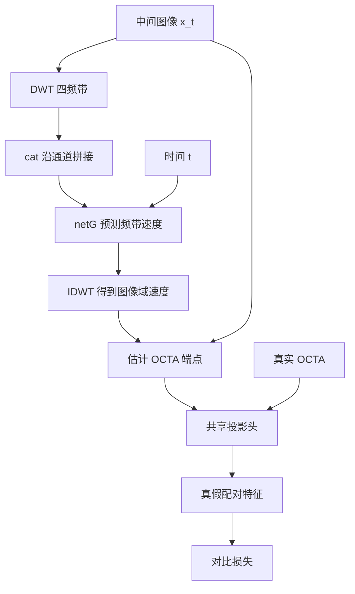

# FlowOCT 补充讲解：小波拼接、投影头、对比损失与训练恢复

日期：2026-10-13。依据本地原始模型与 PyTorch 官方文档。配套人工数据示例已运行通过：[learning/05_dwt_contrast_checkpoint.py](D:/data/code/keyan_fuxian/FlowOCT/learning/05_dwt_contrast_checkpoint.py)。

先把检查点问题说准确：**只保存网络权重仍能用于生成，也能从已有权重继续训练；它缺少优化器历史等状态，所以不能据此完整延续未中断的训练过程。** 权重保存了网络已经学到的映射，不是没有意义的文件。

## 1. 哪些来自库，哪些由项目组合实现

| 代码/名称 | 来源或性质 |
|---|---|
| torch.cat、torch.zeros、torch.arange、torch.eye | PyTorch 张量函数 |
| nn.Sequential、Conv2d、ReLU、AdaptiveAvgPool2d、Flatten、Linear | PyTorch 模块 |
| F.normalize、F.cross_entropy | torch.nn.functional 中的 PyTorch 函数 |
| DiffusionModelUNet | MONAI 提供的网络类 |
| DWT_2D、IDWT_2D | 本项目 util 文件里的小波实现 |
| self.contrast_projection_head | 项目把 PyTorch 层组合成的一个子网络 |
| _contrastive_loss | 项目定义的方法，使用 PyTorch 函数组合对比学习目标 |
| save、load | 项目定义的保存/加载方法，内部调用 PyTorch |

这里的“项目定义”指在仓库代码里实现，不证明算法或代码由作者独立原创；是否参考过其他实现，需要另外核查来源。自己写实验通常也采用“库提供基础层和运算，研究代码决定组合与学习目标”的方式。

## 2. 四个小波频带怎样拼接

使用两张单通道切片作为例子，x_t 的形状是 `(M,C,H,W)=(2,1,32,32)`。这是已经抽取并展平后的二维切片批，不包含体数据的 D 轴。

```python
LL, LH, HL, HH = self.dwt_2d(x_t)
```

调用 DWT 模块，接收四个返回张量；左侧四个变量是解包语法。L/H 表示低通/高通：LL 是两方向低频，LH/HL 是一低一高，HH 是两方向高频。两个方向的具体轴约定以实现为准。

偶数空间尺寸下，每个频带形状为 `(2,1,16,16)`。这是四种频率表示，不能按“四张相互独立的 OCT 病例”理解。

```python
x_t_dwt = torch.cat([LL, LH, HL, HH], dim=1)
```

`[LL,LH,HL,HH]` 是 Python 列表；`cat` 沿指定的已有轴连接张量；`dim=1` 是关键字参数，指定第二个轴。轴编号从 0 开始：

| dim | 当前四维张量里的含义 |
|---:|---|
| 0 | M：切片样本数 |
| 1 | C：通道数 |
| 2 | H：高度 |
| 3 | W：宽度 |

因此：

```text
LL (2,1,16,16) ┐
LH (2,1,16,16) ├─ 沿通道拼接 → (2,4,16,16)
HL (2,1,16,16) │
HH (2,1,16,16) ┘
```

拼接结果的通道顺序是 LL、LH、HL、HH。对每个样本，它的四种频带表示共同作为网络输入。cat 不把数值相加，也不求平均。

若同样四个频带改用 dim=0，形状会变为 `(8,1,16,16)`，把它们组织到样本轴；改用 dim=2 则是 `(2,1,64,16)`。dim 的选择决定数据的组织含义。[PyTorch torch.cat](https://docs.pytorch.org/docs/stable/generated/torch.cat)

## 3. netG 输出什么，IDWT 为什么还要切四次

```python
pred_dx_dwt = self.netG(x_t_dwt, t)
```

netG 是前面创建的 MONAI 网络。输入四频带图像和每张切片的时间 t；本例时间形状为 `(2,)`。网络输入和输出都是 `(2,4,16,16)`，但输出代表**预测速度的四频带**，不是原输入频带的简单复制，也不是四张完整 OCTA。

```python
pred_dx = self.idwt_2d(
    pred_dx_dwt[:, 0:1],
    pred_dx_dwt[:, 1:2],
    pred_dx_dwt[:, 2:3],
    pred_dx_dwt[:, 3:4],
)
```

这是将四通道输出拆成四个单通道频带，再通过逆变换得到图像域速度：

| 索引 | 取出什么 | 形状 |
|---|---|---|
| [:,0:1] | 第 0 通道，即低频速度频带 | (2,1,16,16) |
| [:,1:2] | 第 1 通道 | (2,1,16,16) |
| [:,2:3] | 第 2 通道 | (2,1,16,16) |
| [:,3:4] | 第 3 通道 | (2,1,16,16) |

第一个冒号表示全部样本。`0:1` 的停止端不包含在内，所以只选通道 0，并保留通道轴。`[:,0]` 则会删除该轴，变成 `(2,16,16)`；这里的小波接口要求四维张量。

IDWT 将预测频带组合为 `(2,1,32,32)` 的 pred_dx。若对原始 LL/LH/HL/HH 执行 IDWT，可以重建 x_t；这里执行的是对**预测速度频带**的逆变换，所以得到的是速度。

接着才根据速度估计 OCTA 端点：

```python
pred_octa_flat = x_t + (1 - t_img) * pred_dx
```

完整数据路径：



## 4. 投影头是怎样写出来的

```python
import torch.nn as nn

self.contrast_projection_head = nn.Sequential(
    nn.Conv2d(1, 64, 3, padding=1),
    nn.ReLU(),
    nn.AdaptiveAvgPool2d((1, 1)),
    nn.Flatten(),
    nn.Linear(64, 128),
).to(self.device)
```

nn 是 torch.nn 的别名。各个层由 PyTorch 实现；作者选择这些层、尺寸和顺序，把它们组合成自己的投影头。Sequential 会将上一层输出依次交给下一层，最后返回最后一层的结果。[PyTorch Sequential](https://docs.pytorch.org/docs/stable/generated/torch.nn.modules.container.Sequential.html)

这一段创建模块；下面的代码才实际送入图像执行它：

```python
feat_fake = self.contrast_projection_head(pred_octa_flat)
feat_real = self.contrast_projection_head(octa_flat)
```

真假图像经过同一个投影头，使用同一套权重。输入是图像域的预测/真实 OCTA，不是四通道小波张量。

| 层 | 具体作用 | 本例输出形状 | 有训练参数吗 |
|---|---|---|---|
| 输入 | 两张单通道切片 | (2,1,32,32) | 数据 |
| Conv2d(1,64,3,padding=1) | 64 个 3×3 卷积核提取特征，默认 stride=1 | (2,64,32,32) | 有 |
| ReLU | 将负激活置 0 | (2,64,32,32) | 无 |
| AdaptiveAvgPool2d((1,1)) | 每个通道的整张特征图求平均，输出 1×1 | (2,64,1,1) | 无 |
| Flatten | 默认从 dim=1 起合并轴，保留样本轴 | (2,64) | 无 |
| Linear(64,128) | 将每个 64 维特征转换为 128 维 | (2,128) | 有 |

例如第一个样本的第 c 个池化特征，是该通道 32×32 个数的均值。平均池化后保留了全局特征，精确空间位置不再由这些均值直接表达。

Conv2d 中四个参数可写得更明确：

```python
nn.Conv2d(in_channels=1, out_channels=64, kernel_size=3, padding=1)
```

默认 stride=1；3×3 卷积与 padding=1 保持 H/W。Linear 则包含形状 `(128,64)` 的权重和 128 维偏置，输出可写为 `y = Wz + b`。

此投影头有 8,960 个训练参数，初始化后通过对比损失学习。128 是设计选择，不是 OCTA 图像的宽度。这里的“投影”指把图像映射到特征空间，与 proj_loss 的“最大强度投影”属于不同操作。

## 5. 对比损失：从两对切片开始理解

```python
def _contrastive_loss(self, feat_fake, feat_real, temperature=0.1):
    D = feat_fake.shape[0]
```

这是项目定义的实例方法。单下划线是内部辅助方法的惯例。temperature=0.1 是参数默认值。

这里的 D 是**配对切片数量 M**，与 forward 中体数据形状里的 D 不同。两者在不同方法的局部作用域中，不能按名字视为同一个量。自己写时可命名 num_pairs。

假设有两对：fake_0 对应 real_0；fake_1 对应 real_1。真正的投影头输出是 `(2,128)`，下面仅用两个特征分量演示运算。

### 5.1 拼接与归一化

```python
features = F.normalize(torch.cat([feat_fake, feat_real], dim=0), dim=1)
```

两组 `(2,128)` 沿样本轴拼成 `(4,128)`，行顺序是 fake_0、fake_1、real_0、real_1。dim=1 的归一化逐行处理每个特征向量，让非零向量长度成为 1。例如 `[3,4]` 的长度为 5，归一化后是 `[0.6,0.8]`。[PyTorch normalize](https://docs.pytorch.org/docs/main/generated/torch.nn.functional.normalize.html)

此处 normalize 是特征向量长度归一化，与数据预处理将图像强度缩放到 [0,1] 不同。

### 5.2 相似度矩阵

```python
sim = features @ features.T
```

`@` 是矩阵乘法；这里 features 为二维，`.T` 交换行列。形状 `(4,128) @ (128,4) → (4,4)`。sim[i,j] 是第 i 行与第 j 行特征的点积，非零向量归一化后即余弦相似度。

为演示配对，设 fake_0=real_0=[1,0]、fake_1=real_1=[0,1]，得到：

```text
         f0  f1  r0  r1
f0       1   0   1   0
f1       0   1   0   1
r0       1   0   1   0
r1       0   1   0   1
```

### 5.3 标出正样本位置

```python
pos_mask = torch.zeros(2 * D, 2 * D, dtype=torch.bool, device=features.device)
pos_mask[torch.arange(D), torch.arange(D) + D] = True
pos_mask[torch.arange(D) + D, torch.arange(D)] = True
```

zeros 创建 4×4 掩码；bool 表示元素为 True/False；device 保持与特征一致。arange(2) 生成 `[0,1]`，加 D 后得到 `[2,3]`。

第一句索引标出 `(0,2)`、`(1,3)`；第二句标出反方向 `(2,0)`、`(3,1)`。这里行、列索引是逐项配对，不是所有行列组合。

用 1 表示 True、0 表示 False：

```text
正样本掩码：
0 0 1 0
0 0 0 1
1 0 0 0
0 1 0 0
```

### 5.4 排除自身与正样本，得到负样本

```python
neg_mask = ~(torch.eye(2 * D, dtype=torch.bool, device=features.device) | pos_mask)
```

eye 创建对角线为 True 的单位矩阵，标记每个特征与自己的比较；布尔张量的 `|` 是逐元素或，`~` 是逐元素非。

因此先合并“自己”和“正样本”，再取反，得到负样本位置：

```text
负样本掩码：
0 1 0 1
1 0 1 0
0 1 0 1
1 0 1 0
```

例如 f0 的正样本是 r0，负样本是 f1、r1；自己与自己不参与这个分类问题。

### 5.5 整理为每行一个正候选、若干负候选

```python
pos_sim = sim[pos_mask].view(2 * D, 1)
neg_sim = sim[neg_mask].view(2 * D, -1)
```

布尔索引按掩码选择值，先得到一维结果。四行各有一个正样本值，共 4 个，view 后是 `(4,1)`；每行有两个负样本值，共 8 个，view 后是 `(4,2)`。

一般有 M 对时：正分数为 `(2M,1)`，负分数为 `(2M,2M-2)`。

```python
logits = torch.cat([pos_sim, neg_sim], dim=1) / temperature
labels = torch.zeros(2 * D, dtype=torch.long, device=features.device)
return F.cross_entropy(logits, labels)
```

每行整理成 `[正样本分数,负样本1分数,负样本2分数]`，正确候选始终在第 0 列，所以 labels 为 `[0,0,0,0]`。标签表示候选列编号，与图像是否为“类别 0”无关。long 是整数类别索引需要的数据类型。

temperature=0.1 将分数放大 10 倍。在本例中，每行原分数是 `[1,0,0]`，logits 是 `[10,0,0]`。logits 不是概率；cross_entropy 内部处理分数，令正确候选的概率提高。对一行可写为：

\[
p_+=\frac{e^{s_+/\tau}}{e^{s_+/\tau}+\sum_j e^{s_{-,j}/\tau}},\qquad \mathcal L=-\log p_+.
\]

最后对各行求均值。无需先调用 softmax。[PyTorch cross_entropy](https://docs.pytorch.org/docs/stable/generated/torch.nn.functional.cross_entropy)

配套示例实际结果：正确配对的损失约 0.0000908；交换真实配对后约 10.00009。它验证的是配对目标的机制，而不是医学预测性能。

M=1 时没有负样本，logits 只有一列，因此此实现损失和特征梯度均为零。真实任务中，所有非配对切片被视作负样本，是否存在相近结构被错误当作负样本，需要结合数据检查。

### 5.6 谁在学习

投影头从真假两条特征分支获得参数梯度；netG 经预测图像分支获得梯度。真实图像的数据本身不是优化器更新的参数，但投影头对它做计算时，投影头权重仍然可以学习。

## 6. 只保存网络状态还有什么用

原方法分别保存 netG 和投影头的 state_dict：

```python
torch.save(self.netG.state_dict(), ...)
torch.save(self.contrast_projection_head.state_dict(), ...)
```

网络 state_dict 保存参数和已登记缓冲量：卷积核、线性层权重、偏置等实际学习成果。通过它可以：

- 加载学好的网络进行生成、验证和部署。
- 保存最优模型，比较不同训练轮次和实验。
- 从已有权重继续训练，或作为后续微调的起点。

Adam 状态属于优化器，单独保存在 optimizer.state_dict 中；它包含优化步数、梯度的一阶/二阶移动平均以及参数组设置。epoch/global_step 是训练进度；随机状态决定后续抽样序列。它们不是 netG.state_dict 自动涵盖的内容。[PyTorch 保存与恢复训练教程](https://docs.pytorch.org/tutorials/beginner/saving_loading_models.html)

源码没有解释为什么未保存这些状态，不能确认是作者刻意简化还是遗漏。可以确定的是：当前 continue_train 加载网络权重，但 Adam 重新创建，没有恢复先前积累的优化器历史。

### 6.1 实际恢复对照

配套脚本用 CPU 上只有一个权重的小线性网络验证 Adam 的影响，固定相同数据与更新规则：

| 路径 | 恢复后、更新前的权重 | 相同数据再更新一步后的权重 |
|---|---:|---:|
| 未中断继续训练 | 0.37671864 | 0.38806790 |
| 只恢复网络权重，创建新 Adam | 0.37671864 | 0.42671862 |
| 恢复网络权重和 Adam 状态 | 0.37671864 | 0.38806790 |

三条路径起点相同。只恢复权重也完成了下一步训练，只是更新结果不同；恢复 Adam 状态在这个受控例子里与未中断路径一致。

### 6.2 自己写实验的基本检查点

下面是保存格式示例，epoch、global_step、checkpoint_path 由训练循环提供：

```python
checkpoint = {
    'netG': model.netG.state_dict(),
    'projection_head': model.contrast_projection_head.state_dict(),
    'optimizer': model.optimizer_G.state_dict(),
    'epoch': epoch,
    'global_step': global_step,
}
torch.save(checkpoint, checkpoint_path)
```

加载前，先创建相同网络和优化器：

```python
checkpoint = torch.load(checkpoint_path, map_location=model.device, weights_only=True)
model.netG.load_state_dict(checkpoint['netG'])
model.contrast_projection_head.load_state_dict(checkpoint['projection_head'])
model.optimizer_G.load_state_dict(checkpoint['optimizer'])
restored_epoch = checkpoint['epoch']
restored_step = checkpoint['global_step']
```

这是一份新的完整字典格式，保存和加载两端需要配套。原 load 读取的是两个单独的网络 state_dict，不能直接用它解释这份新字典；还应调整初始化阶段的加载分支。

若要尽量延续未中断时的采样与更新，还应保存实际使用的 Python/NumPy/PyTorch/CUDA 随机状态、数据迭代位置、scheduler 和混合精度 scaler 状态等。仅恢复网络、优化器、轮数并不自动保证所有环境中逐步结果完全一致。按 epoch 边界保存，更容易组织数据迭代恢复。

不是所有临时变量都必须保存。通常在完成 optimizer.step 后的边界保存；下一批的预测、loss 和计算图可以重新计算。

## 7. 怎样运行本次示例

```powershell
& 'D:\software\anaconda3\envs\flowoct\python.exe' 'D:\data\code\keyan_fuxian\FlowOCT\learning\05_dwt_contrast_checkpoint.py'
```

示例依次展示真实小波/网络形状、投影头逐层输出、两对特征的掩码与 logits，以及 Adam 恢复对照。小波部分遵循原实现，在有 CUDA 时使用当前 CUDA 设备。网络未训练，人工数据只用于检查机制。

自测：

1. 四个 `(2,1,16,16)` 张量沿 dim=1 拼接，为什么结果为 `(2,4,16,16)`？
2. IDWT 对原频带与预测速度频带分别产生什么？
3. 投影头的 64 和 128 各表示什么？
4. 对比损失里的 D 与体数据里的 D 为什么不能直接混同？
5. 两对切片时，每行有哪些正、负候选，为什么 labels 都为 0？
6. 恢复相同权重后，新的 Adam 为什么可能给出不同的下一步更新？
