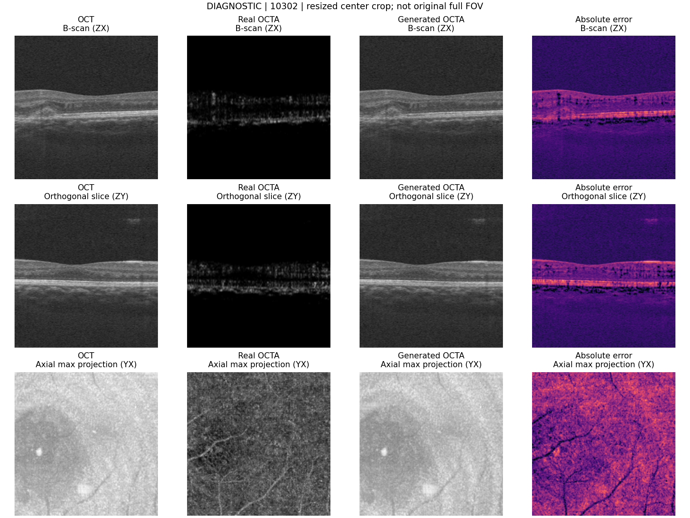

# 实际验证记录

## 2026-10-21：A100自动部署入口的本地验证

新增入口 `a100.py`，模型、损失、数据预处理和训练循环源码哈希保持不变。新增7项本地部署测试覆盖：在改名的数据目录内解压且没有native、多个候选目录拒绝默认选择、空目录拒绝、配置只改manifest/device、恢复读取原配置、已有run防覆盖，以及诊断/分批旧run不得被误作正式整批run恢复。日志见 [a100_launcher_tests.txt](verification/a100_launcher_tests.txt)。

这些是本地目录/参数/恢复入口验证，**没有连接目标A100，也没有在A100上完成显存或训练测试**。新包解压后的 `python a100.py check` 才负责在你的实际环境执行真实审计、正式尺寸单步及完整保存/重载/推理诊断。下文为2026-10-20原服务器的历史硬件证据。

验证日期：2026-10-20（北京时间）。服务器：`eias-member.eitech.edu.cn`；运行目录：`/docsystem/niuke/lvyuehang/flowoct_reproduction`。GPU 为第二张 RTX 3090，24GB；环境为独立 `lyh_flowoct` venv，Python 3.10.22、PyTorch 2.5.1+cu121、MONAI 1.4.0、TorchIO 0.20.4、NumPy 1.26.4。

**当前默认已恢复作者整批执行：network_chunk=0，推理每批32张，训练预算200轮。第二张24GB 3090再次整批测试仍显存不足，尚未完成一次参数更新。** 下列正式尺寸成功运行采用的是旧分批重计算模式，不能作为整批配置通过的证据。本次没有启动全部病例的200/400轮训练，没有产生可与论文表格比较的最终模型。

## 检验范围和证据

| 检验 | 实际范围 | 结果 | 证据 |
|---|---|---|---|
| 3M 清单审计 | 全部 200 个病例；140/10/50 | 通过路径、配对形状、轴/病例元数据及跨集合分组检查 | [audit_3m.json](verification/audit_3m.json) |
| 6M 清单审计 | 全部 300 个病例；180/20/100 | 同上 | [audit_6m.json](verification/audit_6m.json) |
| 核心测试 | Windows 和服务器各 8 项 | 全部通过；含非零 y 起点的投影 ROI NaN 回归案例 | [服务器日志](verification/server_unit_tests.txt)、[本地日志](verification/local_unit_tests.txt) |
| 3M 短程完整流程 | 训练 10301、验证 10302；32³，一次训练更新 | 更新、验证、最佳权重、重载后生成、评价通过 | [3M 运行指标](verification/real_smoke_3m/train/epochs.jsonl)、[重新加载后的结果](verification/real_smoke_3m/predictions/prediction.json) |
| 6M 短程完整流程 | 训练 10001、验证 10005；32³，一次训练更新 | 同上 | [6M 运行指标](verification/real_smoke_6m/train/epochs.jsonl)、[重新加载后的结果](verification/real_smoke_6m/predictions/prediction.json) |
| 3M 正式尺寸单步（旧分批模式） | 10301；输入 [1,1,256,256,256]，64 张抽片，network_chunk=4 | 四项损失有限，反向和 Adam 更新通过 | [benchmark_3m_256.json](verification/benchmark_3m_256.json) |
| 6M 正式尺寸单步（旧分批模式） | 10001；相同正式尺寸、64 张抽片和 network_chunk=4 | 同上 | [benchmark_6m_256.json](verification/benchmark_6m_256.json) |
| 3M 正式尺寸完整流程（旧分批模式） | 训练 10301、验证 10302；256³，network_chunk=4，一次更新 | 验证、选模、权重重载、完整三步生成、保存和重新计算评价通过 | [完整流程日志](verification/fullsize_3m.log)、[预测记录](verification/fullsize_3m/predictions/prediction.json)、[评价](verification/fullsize_3m/evaluation/summary.json) |
| epoch 边界完整恢复 | 同一张 3090，真实数据 32³；连续两轮 vs 一轮后恢复再一轮 | 网络张量逐位一致、Adam 状态一致、global step=2 一致、最佳验证 PSNR 一致 | [comparison.json](verification/resume_replay/comparison.json) |
| 作者整批执行方式（首次） | 3M 正式尺寸、64 张片、关闭网络分批 | CUDA 显存不足 | [显存记录](verification/benchmark_3m_unchunked.json)、[原始错误](verification/benchmark_3m_unchunked.log) |
| 作者整批执行方式（本次重试） | 第二张3090启动前空闲；3M 256³、64张、FP32、network_chunk=0、推理批量32、预算200 | 对比头 ReLU 再申请1 GiB时显存不足；PyTorch已分配22.11 GiB，尚未反向更新 | [重试记录](verification/benchmark_3m_unchunked_retry.json)、[完整错误](verification/benchmark_3m_unchunked_retry.log) |
| 依赖完整性 | 独立服务器 venv | `No broken requirements found` | [server_environment_freeze.txt](verification/server_environment_freeze.txt) |

本次默认参数调整后，还在服务器逐项核对了19个受记录源码/配置的SHA256、两份配置的整批/200轮参数、启动脚本语法，以及3M/6M的训练→保存配置推理→评价参数传递。参数传递检查使用回显解释器，不启动训练。重试记录中的模型、数据与损失源码指纹与当前交付一致。

8 项测试分别覆盖：常量体拒绝、患者/图像重复组跨集合拒绝、ZYX→YXZ 轴转换及配对归一化、分批重计算的目标和梯度、小波子带符号/顺序/重建/梯度、有限指标、完整 checkpoint 下一步恢复、投影通道索引回归。

清单审计读取全部文件头和小型元数据，没有对 500 个体全部解压并做体素哈希。本次读取体素验证的是上述实际运行病例。需要全量检查时使用 `audit --deep`；它的耗时和读盘开销不应与已完成的头检查混淆。

## 显存和时间

| 实验 | 网络批量 | 所有抽片数 | 峰值 allocated | 单次网络前向/反向/Adam |
|---|---:|---:|---:|---:|
| 3M 正式尺寸 | 每批 4，重计算 | 64 | 4.38345 GiB | 7.07 秒 |
| 6M 正式尺寸 | 每批 4，重计算 | 64 | 4.38380 GiB | 3.16 秒 |
| 3M 作者整批路径 | 64 | 64 | 报错时已分配约 22.11 GiB | 再申请 1 GiB 时失败 |
| 3M 作者整批路径重试 | 64 | 64 | 报错时已分配约 22.11 GiB | 约5.55秒后在对比头申请1 GiB时失败，尚未更新 |

生成器实际参数为 **2,330,180**，来自锁定 MONAI 默认 2D DiffusionModelUNet；没有用更小的自建网络代替。对比头单独存在并参与优化。

本次重试命令为 `python scripts/benchmark.py --config configs/3m.json --device cuda:1 --network-chunk 0 --output verification/benchmark_3m_unchunked_retry.json`。没有减少抽片、启用AMP、自动改回分批或改动网络结构；失败进程已退出并释放显存。A100目标地址和显存尚未确认，尚未在A100上验证。

表中是各一次测量，排除文件加载、TorchIO 预处理、模型初始化、验证和压缩写盘，且受首次 CUDA 算子开销和共享服务器状态影响。它们用于证明代码和预算可运行，不能用于比较 3M/6M 稳定速度或估算完整训练总时长。

3M 正式尺寸完整流程中，一次训练更新含读盘约 14.74 秒，一例完整验证约 19.96 秒；同样不是多轮稳定吞吐量。PyTorch 的 allocated 指标也不等于系统监控显示的全部显存占用。

## 恢复与数值边界

恢复测试走的是实际训练入口和真实清单，创建两份独立实验：一份完成两轮；另一份完成一轮、销毁模型后从 `latest.pt` 重新建立网络和 Adam，再完成第二轮。第二轮后对全部网络张量与 Adam 状态逐一比较。

这验证的是相同软件、同一 GPU 上的 epoch 边界恢复；没有承诺 batch 中途恢复、跨 GPU/跨版本逐位一致。分批重计算与整批路径保留相同目标和样本集合，允许浮点归约误差；Adam 可能放大接近零的偏置梯度差异，不能声称它们的最终权重逐位相同。

每次运行的 `environment.json` 记录当时源码 SHA256；诊断记录中包括适配开发期间新增运行标记和命令选项的版本。最终交付源码指纹统一见 `provenance/source_manifest.json`。本次所有成功数值验证使用相同的 `model.py`、`data.py`、小波和 ROI 运算。

## 诊断结果的正确用途

以下预览来自**仅一次参数更新**后的 3M 验证病例，用于检查配对、轴向、保存和画图；明显尚未学成 OCT→OCTA。不能作为复现性能、诊断准确度或临床质量证据。

短程与正式尺寸诊断都只用训练集/验证集，没有运行测试集选模。正式评价脚本已提供，但本次没有完整遍历 50/100 个测试体做最终性能报告。

未完成或无法由公开材料唯一确定的部分：完整 200/400 轮收敛训练、作者确切病例 ID/离线视网膜 ROI、论文全部 foreground/分层/LPIPS/FID/诊断协议，以及原始 640 深度或全横向 FOV 的恢复。相关边界已写入 [CHANGES.md](CHANGES.md)。

代码包保存轻量日志、配置、汇总和预览，不复制医学原始数据，也不附诊断权重/大体积预测文件。服务器的 `verification/` 中保留这些短程运行原件，可按 README 命令重新生成。
